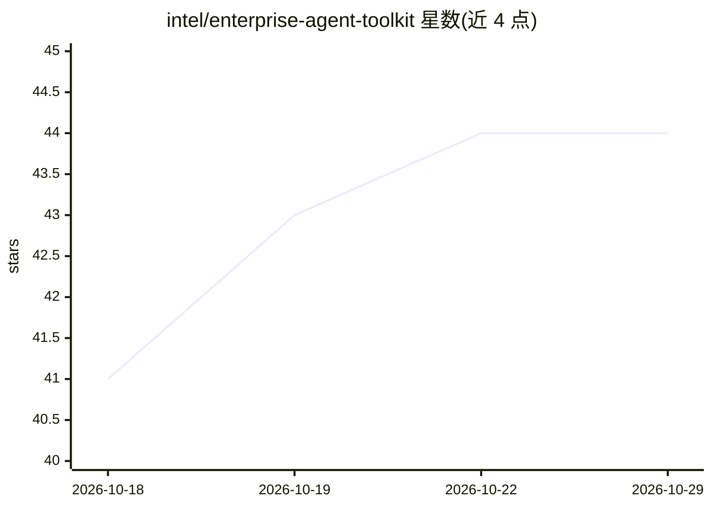

# intel/enterprise-agent-toolkit

⭐ 44 · Shell · Apache-2.0 · 推送 2026-10-28 · [GitHub](https://github.com/intel/enterprise-agent-toolkit) · 组织维护

**面向企业部署 Agentic AI 的 Kubernetes 平台工具包（Intel Xeon 优化）**

Intel 维护的企业级 Agentic AI 部署工具包：在 Intel Xeon 与 Intel 加速器上，以 Kubernetes/Helm（或 Docker Compose）一键部署完整 agent 基础设施，覆盖 LiteLLM 策略化 API 网关、智能推理路由（含多臂老虎机学习的 Hybrid Router）、Redis/pgvector 记忆与 RAG、Kubernetes Pod 沙盒代码执行（可选 Kata Containers microVM 隔离）、MCP 工具层与 Langfuse/Prometheus/Grafana 可观测性。采用 Provider Design Pattern，各功能块可逐个替换；验证支持 LangGraph、CrewAI、Flowise、OpenClaw 等编排框架与 OpenAI/Claude/Gemini/vLLM/SGLang 等模型后端。通过 deploy-agentic-stack.sh 脚本部署，属 AI 基础设施/部署编排类工具，不直接面向终端用户产出内容。

## 筛选速览

| 维度 | 判定 | 备注 |
|---|---|---|
| AI 角色 | `ai-ecosystem` | LLM/agent 周边工具 |
| 许可风险 | `permissive` | Apache-2.0 |
| 部署形态 | `self-host` | docker 或自建部署 |
| 模型依赖 | local-ok | 支持本地模型 |
| 硬件要求 | — | 无带数字的原话,不猜 |
| 安装摩擦 | `low` | 无编译、无系统依赖或容器化 |
| 成熟度 | — | 结构信号不足 |

## 能力要点

- 七类可插拔 Provider 块（网关/推理路由/工具/沙盒/记忆/可观测性/部署编排），默认实现均经 Intel Xeon 验证
- Hybrid Router 按复杂度分级路由并用在线多臂老虎机学习最优候选模型
- Agent 沙盒为独立临时 Pod，可选 Kata Containers microVM 级隔离（Firecracker/QEMU）
- 支持 Kubernetes/Helm 多节点与 Docker Compose 单机两种部署方式，同一配置

## 适用场景

- 企业在自有 Intel Xeon 服务器上部署生产级 Agentic AI 平台
- 为 AI agent 提供带认证、限流与审计的统一 LLM API 网关
- 搭建带记忆、RAG 与沙盒代码执行的多 agent 运行环境
- 本地开发/演示时用 Docker Compose 快速拉起同一套栈

## 场景标签

`Agent 框架` `模型网关` `RAG` `LLM 可观测性` · 领域:Agent 开发

## 证据(README 行号)

> L20: Most organizations waste months stitching together LiteLLM, Redis, pgvector, Kubernetes, Langfuse, and agent sandbo
> L44: Each functional block in the toolkit follows a **Provider Design Pattern**: the block defines the capability contra
> L89: ### Deployment & Orchestration

## 星数曲线

2026-10-18 41 → 2026-10-29 44（+3）

---
*卡片 v1 · prompt 1.4 · 生成 2026-10-25 · 置信度 high · 依据 README sha `4081e1886c17` · [字段定义](../../DATASET.md)*
