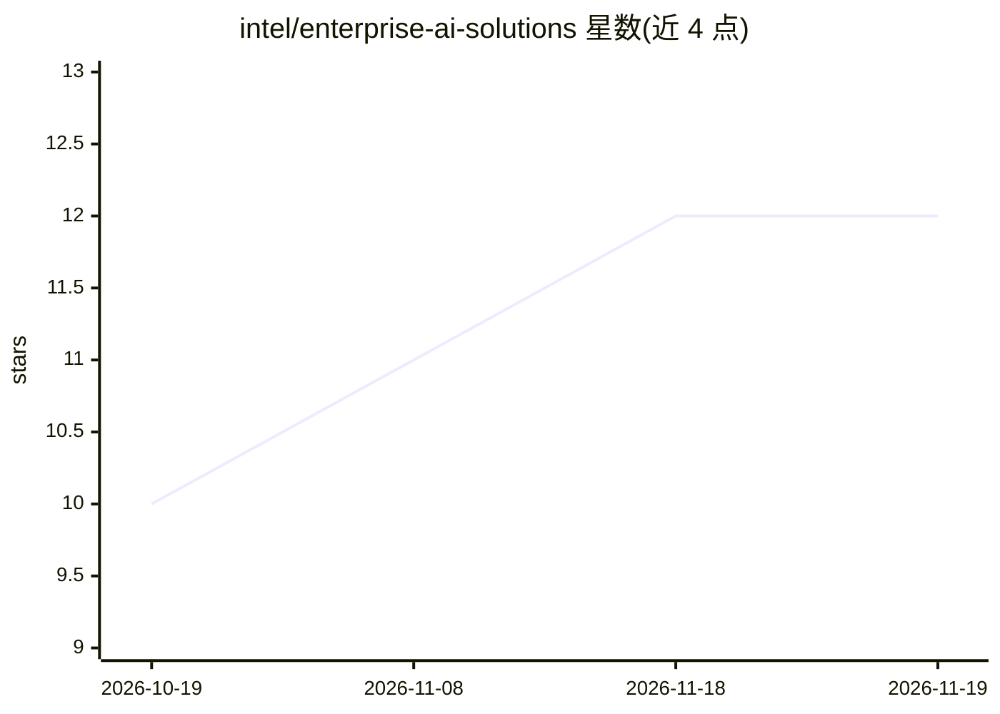

# intel/enterprise-ai-solutions

⭐ 12 · Python · Apache-2.0 · 推送 2026-11-18 · [GitHub](https://github.com/intel/enterprise-ai-solutions) · 组织维护

**给企业在 Xeon 上一键部署 Kubernetes LLM 推理平台**

Toolkit Manager 是 Intel 维护的安装器仓库：一条脚本完成 Kubernetes 供给（Kubespray）、平台服务（Istio、Envoy Gateway、Keycloak、PostgreSQL、可观测性栈）、以及 vLLM/OpenVINO Model Server 模型服务部署，对外暴露 OpenAI 兼容端点。可选层含 Chatbot Toolkit（RAG、向量库、Web UI）与 Agent Toolkit（沙箱、LiteLLM 虚拟密钥、路由）。前置条件为 Ubuntu 22.04/24.04 或 RHEL/Rocky、免密 sudo。

## 筛选速览

| 维度 | 判定 | 备注 |
|---|---|---|
| AI 角色 | `ai-ecosystem` | LLM/agent 周边工具 |
| 许可风险 | `permissive` | Apache-2.0 |
| 部署形态 | `None` |  |
| 模型依赖 | local-ok | 支持本地模型 |
| 硬件要求 | — | 无带数字的原话,不猜 |
| 安装摩擦 | `low` | 无编译、无系统依赖或容器化 |
| 成熟度 | — | 结构信号不足 |

## 能力要点

- 单一安装脚本 es_auto_installer.sh 从裸金属到可用 AI 栈
- OpenAI 兼容 API 端点，配合 vLLM 与 OpenVINO Model Server
- 内置 Keycloak 认证、Envoy AI Gateway 与 Grafana/Prometheus/Loki/Tempo 可观测性
- 可选 RAG（Chatbot Toolkit）与 Agent（Agent Toolkit）层

## 适用场景

- 在企业 Xeon 服务器上搭建生产级 LLM 推理端点
- 部署带文档摄取与聊天界面的 RAG 应用
- 为自研应用或 agent 框架接入 OpenAI 兼容接口

## 场景标签

`推理引擎` `RAG` `聊天机器人` · 领域:对话与助手

## 证据(README 行号)

> L12: > Deploy and connect LLM inference, RAG, and agentic workflows in a customizable Kubernetes-based platform — with a
> L20: A single installer script, `es_auto_installer.sh`, takes bare-metal nodes through Kubernetes provisioning, platform
> L34: |3|**Intel® Inference Toolkit**|Envoy AI Gateway, KServe, vLLM / OpenVINO™ Model Server — exposes the model endpoin

## 星数曲线

2026-10-19 10 → 2026-11-19 12（+2）

---
*卡片 v1 · prompt 1.4 · 生成 2026-11-18 · 置信度 high · 依据 README sha `2a9d5ea37108` · [字段定义](../../DATASET.md)*
