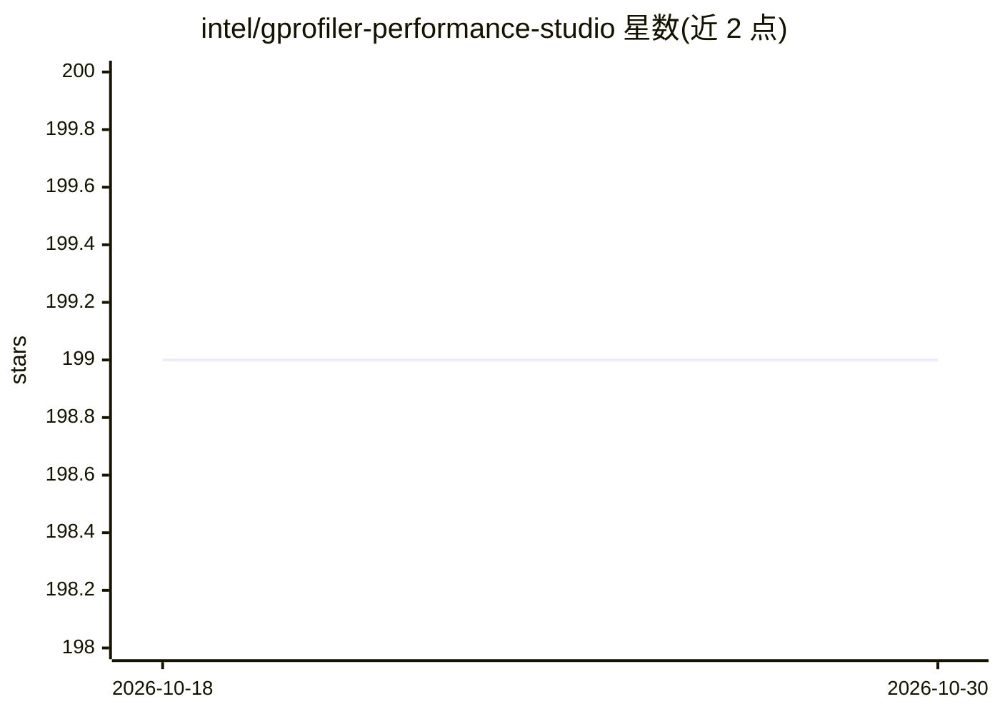

# intel/gprofiler-performance-studio

⭐ 199 · JavaScript · Apache-2.0 · 推送 2026-10-29 · [GitHub](https://github.com/intel/gprofiler-performance-studio) · [官网](https://github.com/intel/gprofiler-performance-studio) · 组织维护

**gProfiler 连续性能分析平台的自托管后端与 UI**

由 Intel Granulate 开发的 Continuous Profiler Performance Studio：本地部署 gProfiler agent 的后端与 Web UI，聚合多个采样剖析器的数据生成统一火焰图，支持持续剖析（数据面：agent 上传 → S3 → SQS → 索引器 → ClickHouse → 火焰图）与按需动态剖析（控制面：心跳协议下发启停命令，可选采集 Intel PerfSpect 硬件指标）。面向开发者、性能工程师与 DevOps。运行需 Docker/docker-compose、AWS 账号（S3+SQS，可用 Minio/RabbitMQ 替代）、TLS 证书与基本认证。

## 筛选速览

| 维度 | 判定 | 备注 |
|---|---|---|
| AI 角色 | `ai-ecosystem` | LLM/agent 周边工具 |
| 许可风险 | `permissive` | Apache-2.0 |
| 部署形态 | `self-host` | docker 或自建部署 |
| 模型依赖 | — | README 未给出锁定关系 |
| 硬件要求 | — | 无带数字的原话,不猜 |
| 安装摩擦 | `low` | 无编译、无系统依赖或容器化 |
| 成熟度 | — | 结构信号不足 |

## 能力要点

- 持续与动态双剖析模式共享同一后端与存储层
- 多语言持续剖析，无需修改代码即可部署
- 动态剖析通过心跳协议下发命令，可选 PerfSpect 硬件指标
- docker-compose 一键启动完整微服务栈，支持集群化 ClickHouse

## 适用场景

- 生产环境持续性能剖析并定位 CPU 热点与回归
- 从 UI 按需对指定主机/PID 发起剖析会话
- 团队自托管 Profiling 平台替代 SaaS 依赖

## 场景标签

`MLOps` · 领域:训练与推理

## 证据(README 行号)

> L4: Developed by Intel® Granulate™ and contributed to the open source community, Continuous Profiler is a solution that 
> L17: This project offers a backend and user interface for the Continuous Profiler agent,

## 星数曲线

2026-10-18 199 → 2026-10-30 199（+0）

---
*卡片 v1 · prompt 1.4 · 生成 2026-10-22 · 置信度 high · 依据 README sha `8e4e73746e1f` · [字段定义](../../DATASET.md)*
