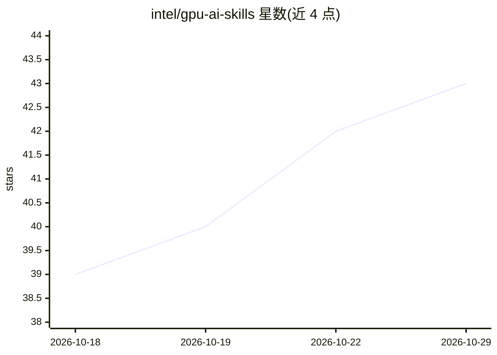

# intel/gpu-ai-skills

⭐ 43 · Python · Apache-2.0 · 推送 2026-10-28 · [GitHub](https://github.com/intel/gpu-ai-skills) · 组织维护

**Intel GPU 上运行/评测/剖析 HF 模型的 Agent Skills 集合**

Intel 维护的 Agent Skills 集合，覆盖在 Intel GPU（Arc、Arc Pro、Battlemage）上部署任意 Hugging Face safetensors/GGUF 模型的全流程：主机初始化（xpu-smi、Level Zero、Docker）、VRAM 估算与部署配置推荐、四种运行栈（PyTorch+Transformers、vLLM-XPU、SGLang-XPU、llama.cpp-SYCL）、基准测试、性能剖析与监控，以及 CUDA→XPU 迁移。技能遵循 Agent Skills 规范，可安装到 Claude Code、Cursor、Gemini CLI、OpenAI Codex 等多种 agent。

## 筛选速览

| 维度 | 判定 | 备注 |
|---|---|---|
| AI 角色 | `ai-ecosystem` | LLM/agent 周边工具 |
| 许可风险 | `permissive` | Apache-2.0 |
| 部署形态 | `self-host` | docker 或自建部署 |
| 模型依赖 | local-ok | 支持本地模型 |
| 硬件要求 | — | 无带数字的原话,不猜 |
| 安装摩擦 | `low` | 无编译、无系统依赖或容器化 |
| 成熟度 | — | 结构信号不足 |

## 能力要点

- 四种运行栈：PyTorch+Transformers、vLLM-XPU、SGLang-XPU、llama.cpp-SYCL
- setup/plan/run/benchmark/profile/migrate 六类共 20+ 个技能
- cuda-to-xpu-migration 与 xpu-port 支持 CUDA 项目迁移
- 安装脚本可批量装入检测到的所有 agent 技能目录

## 适用场景

- 在 Intel Arc GPU 主机上部署并服务 HF/GGUF 模型
- 对 PyTorch/vLLM/SGLang 推理做基准测试与性能剖析
- 把现有 CUDA 训练或推理代码迁移到 Intel XPU

## 场景标签

`推理引擎` `模型评测` · 领域:评测与运维

## 证据(README 行号)

> L17: A collection of Agent Skills for setting up, running, benchmarking, and profiling arbitrary Hugging Face safetensor
> L19: Format follows the Agent Skills specification.

## 星数曲线

2026-10-18 39 → 2026-10-29 43（+4）

---
*卡片 v1 · prompt 1.4 · 生成 2026-10-25 · 置信度 mid · 依据 README sha `f60d293668c0` · [字段定义](../../DATASET.md)*
