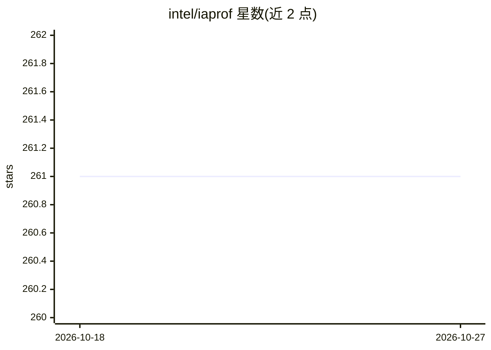

# intel/iaprof

⭐ 261 · C++ · Apache-2.0 · 推送 2026-10-02 · [GitHub](https://github.com/intel/iaprof) · 组织维护

**面向 Intel Xe GPU 的性能剖析器，生成 AI 火焰图**

基于硬件采样的 Intel GPU 性能采集工具：结合 EU stall、CPU 调用栈与 GPU kernel 信息，把 CPU 代码与 GPU 性能指标关联，输出制表符分隔文本流，供外部工具生成火焰图与 subsecond-offset 热力图（附 flamegraph.pl 兼容转换脚本）。面向在 Linux 上调优 Intel Arc/Xe GPU 工作负载的开发者。限制较多：需 Linux 6.15+、带 USDT 探针的 NEO 补丁构建、被剖析程序需启用 frame pointer，以 root 运行且仅支持单个活跃负载，非持续剖析设计。Rust 源码编译安装。

## 筛选速览

| 维度 | 判定 | 备注 |
|---|---|---|
| AI 角色 | `ai-ecosystem` | LLM/agent 周边工具 |
| 许可风险 | `permissive` | Apache-2.0 |
| 部署形态 | `desktop` | 安装包/桌面程序 |
| 模型依赖 | — | README 未给出锁定关系 |
| 硬件要求 | — | 无带数字的原话,不猜 |
| 安装摩擦 | `medium` | 含编译或系统依赖之一 |
| 成熟度 | `idea` | |

## 能力要点

- 硬件采样结合 EU stalls、CPU 栈与 GPU kernel 信息
- 输出可被 ProVis/flamegraph.pl 等外部工具消费的文本格式
- 支持 Intel Arc B-series（Battlemage）与 Core Ultra Arc（Lunar Lake）等 Xe2 设备
- 提供 --interval、--eu-stall-subsample 等采集调优选项

## 适用场景

- 剖析 PyTorch 等 GPU 工作负载，定位 CPU 代码对应的 GPU 性能瓶颈
- 生成火焰图与热力图做 kernel 级性能分析
- 调试 EU stall 与调用栈缺失等剖析问题

## 场景标签

 · 领域:GPU 性能工具/系统性能

## 证据(README 行号)

> L9: This tool collects profiles of Intel GPU performance based on hardware sampling and
> L12: It combines EU stalls,

## 星数曲线

2026-10-18 261 → 2026-10-27 261（+0）

---
*卡片 v1 · prompt 1.4 · 生成 2026-10-22 · 置信度 mid · 依据 README sha `0e94bf627826` · [字段定义](../../DATASET.md)*
