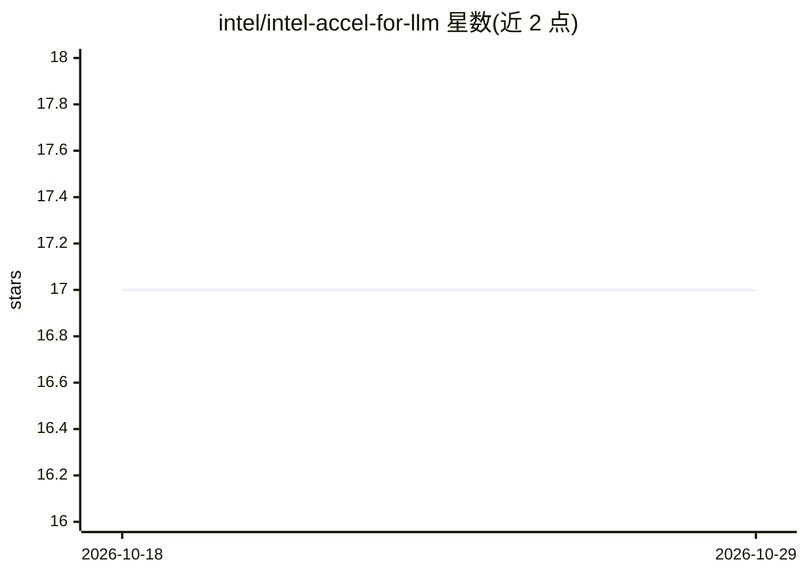

# intel/intel-accel-for-llm

⭐ 17 · C · 推送 2026-10-28 · [GitHub](https://github.com/intel/intel-accel-for-llm) · 组织维护

**利用 Intel 硬件加速器提升 LLM 推理性能的 IAXL 库**

Intel 维护的 LLM 推理加速库：通过 QAT/IAA 硬件压缩 KV cache（DEFLATE、BF16 字节 shuffle），配合 DSA+GDRCopy 做传输，以 KVShrink vLLM V1 KV connector 形式接入 vLLM；提供容器启动脚本、REST 管理 API（cache 状态/逐出/持久化）与跨节点 RDMA KV Cache 复用。安装需内核参数、QAT 驱动、GDRCopy 驱动与 DSA 配置，容器内可 pip 安装。给在 Intel 平台运行 vLLM 的开发者使用。

## 筛选速览

| 维度 | 判定 | 备注 |
|---|---|---|
| AI 角色 | `ai-ecosystem` | LLM/agent 周边工具 |
| 许可风险 | `none` | — |
| 部署形态 | `library` | 以包/库形式分发 |
| 模型依赖 | local-ok | 支持本地模型 |
| 硬件要求 | — | 无带数字的原话,不猜 |
| 安装摩擦 | `medium` | 含编译或系统依赖之一 |
| 成熟度 | — | 结构信号不足 |

## 能力要点

- QAT/IAA/CPU 多后端 KV cache 压缩，环境变量可切换
- KVShrink：vLLM V1 KV connector，TP/DP 资源按 NUMA 拓扑自动配置
- REST 管理 API：cache status/evict/persist
- 跨节点 RDMA KV Cache 存储与复用（remote_pool）

## 适用场景

- 在带 QAT/IAA/DSA 的 Intel 服务器上加速 vLLM 推理
- 压缩 KV cache 降低显存/内存占用并复用缓存
- 跨节点部署远程 KVStore 复用 KV Cache

## 场景标签

`推理引擎` · 领域:训练与推理

## 证据(README 行号)

> L5: `iaxl` uses Intel hardware accelerators to improve LLM inference performance.
> L91: KVShrink is a vLLM V1 KV connector based on IAXL `KVStore`. Configure `setvars.sh`, then start the container:

## 星数曲线

2026-10-18 17 → 2026-10-29 17（+0）

---
*卡片 v1 · prompt 1.4 · 生成 2026-10-29 · 置信度 high · 依据 README sha `89fecb4167d0` · [字段定义](../../DATASET.md)*
