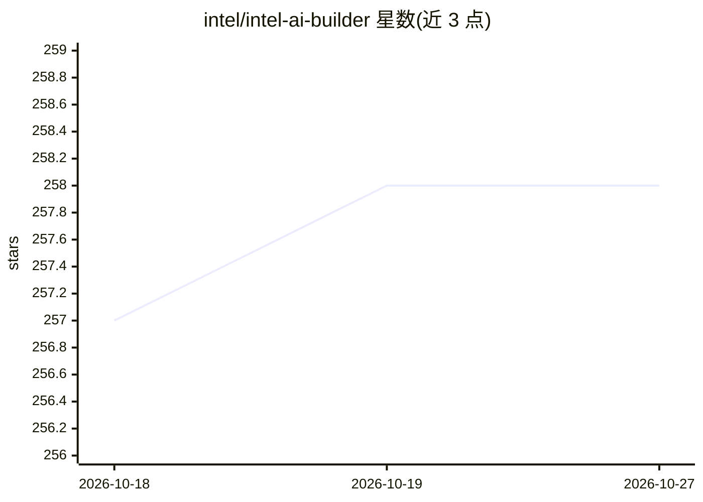

# intel/intel-ai-builder

⭐ 258 · JavaScript · NOASSERTION · 推送 2026-10-21 · [GitHub](https://github.com/intel/intel-ai-builder) · 组织维护

**Intel 的 Gen-AI 参考设计平台，含本地优先 Agent 方案 SuperClaw**

Intel 官方的 Gen-AI 参考设计平台，面向定制行业 AI 助手与 Agent 的构建，含两项产品：SuperClaw 是本地优先的混合 Agentic AI 方案，在 Intel AI PC 上运行编码、深度研究、邮件日历、文件分析、网页搜索等专用 Agent，仅在任务需要时路由到云端模型，采用 PII 感知路由；部署形态为 Windows 客户端应用 + 用户自控的 Linux 推理边缘服务器。SuperBuilder 为另一项产品，README 未展开细节。支持渠道为 GitHub Issues 与邮件。

## 筛选速览

| 维度 | 判定 | 备注 |
|---|---|---|
| AI 角色 | `ai-ecosystem` | LLM/agent 周边工具 |
| 许可风险 | `none` | NOASSERTION |
| 部署形态 | `None` |  |
| 模型依赖 | — | README 未给出锁定关系 |
| 硬件要求 | — | 无带数字的原话,不猜 |
| 安装摩擦 | `low` | 无编译、无系统依赖或容器化 |
| 成熟度 | — | 结构信号不足 |

## 能力要点

- 本地优先混合架构：常规任务在设备端运行，高级推理路由云端
- 内置编码、深度研究、邮件日历、文件分析、网页搜索专用 Agent
- PII 感知路由，敏感数据保留在用户边界内
- 双平面部署：Windows 客户端 + Linux 推理边缘服务器

## 适用场景

- 企业在自有数据与边界内部署行业定制 AI 助手
- 在 Intel AI PC 上本地运行 Agent 并按需调用云端模型
- 降低云端 token 成本同时保持数据隐私

## 场景标签

`AI 助手` `Agent 框架` · 领域:Agent 开发

## 证据(README 行号)

> L5:  Intel® AI Builder is Intel’s Gen-AI reference design platform that enables the rapid creation of custom AI assistan
> L13: **SuperClaw** is a new hybrid agentic AI solution that runs powerful AI agents directly on your Intel AI PC while s
> L19: - ⚡ **Two-plane deployment** — a Windows client app + a Linux Inference Edge Server you fully control

## 星数曲线

2026-10-18 257 → 2026-10-27 258（+1）

---
*卡片 v1 · prompt 1.4 · 生成 2026-10-22 · 置信度 mid · 依据 README sha `73ab58f05c7f` · [字段定义](../../DATASET.md)*
