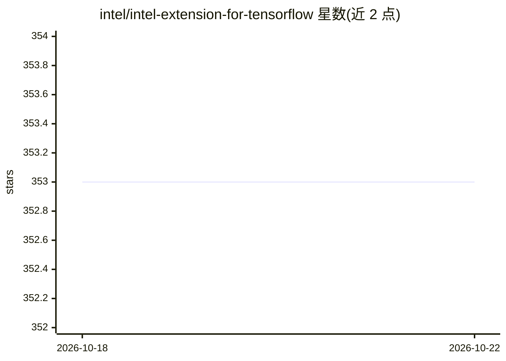

# intel/intel-extension-for-tensorflow

⭐ 353 · C++ · NOASSERTION · 推送 2025-10-29 · [GitHub](https://github.com/intel/intel-extension-for-tensorflow) · 组织维护

**让 TensorFlow 在 Intel CPU/GPU 上运行的扩展插件**

基于 TensorFlow PluggableDevice 接口的深度学习扩展插件，将 Intel CPU 与 GPU（XPU）设备接入 TensorFlow 生态以运行 AI 工作负载。包内含 XPU 特定实现、算子内核、图优化器、设备运行时、后端选择与特性开关。通过 PyPI、DockerHub 容器或源码编译安装；限制：与 TensorFlow 版本严格绑定，最高兼容 TF 2.16（源码构建），不支持 2.17；XPU 路径需安装 Intel GPU 驱动与 oneAPI Base Toolkit。面向使用 Intel 硬件的深度学习开发者与科研用户。

## 筛选速览

| 维度 | 判定 | 备注 |
|---|---|---|
| AI 角色 | `ai-ecosystem` | LLM/agent 周边工具 |
| 许可风险 | `none` | NOASSERTION |
| 部署形态 | `library` | 以包/库形式分发 |
| 模型依赖 | — | README 未给出锁定关系 |
| 硬件要求 | — | 无带数字的原话,不猜 |
| 安装摩擦 | `low` | 无编译、无系统依赖或容器化 |
| 成熟度 | — | 结构信号不足 |

## 能力要点

- 基于 TensorFlow PluggableDevice 接口接入 Intel CPU/GPU
- 提供算子内核、图优化器、设备运行时与 XPU 后端选择
- PyPI/DockerHub/源码三种安装渠道，区分 XPU 与 CPU 版本
- 提供周更构建版本与环境检查脚本

## 适用场景

- 在 Intel CPU 或 GPU 上运行与加速 TensorFlow 训练/推理
- 为已有 TensorFlow 代码接入 Intel XPU 硬件
- 在 Intel 数据中心 GPU 上跑 Stable Diffusion 与分布式训练

## 场景标签

`推理引擎` · 领域:训练与推理

## 证据(README 行号)

> L10: Intel® Extension for TensorFlow* is a heterogeneous, high performance deep learning extension plugin based on Tenso
> L19:  `intel_extension_for_tensorflow` contains:
> L32: Intel® Extension for TensorFlow* provides Intel XPU and Intel CPU support.

## 星数曲线

2026-10-18 353 → 2026-10-22 353（+0）

---
*卡片 v1 · prompt 1.4 · 生成 2026-10-21 · 置信度 high · 依据 README sha `a92e2025db22` · [字段定义](../../DATASET.md)*
