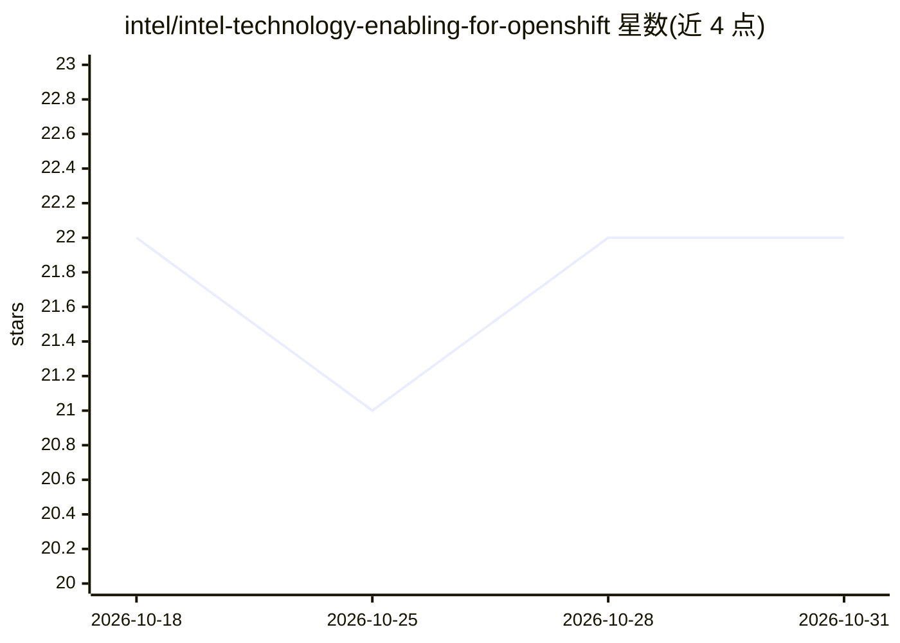

# intel/intel-technology-enabling-for-openshift

⭐ 22 · Python · Apache-2.0 · 推送 2026-01-29 · [GitHub](https://github.com/intel/intel-technology-enabling-for-openshift) · [官网](https://intel.github.io/intel-technology-enabling-for-openshift/) · 组织维护

**在 OpenShift 上供给 Intel AI 加速器与 AI 软件的全栈方案**

Intel 维护的 OpenShift/Kubernetes 平台 AI 基础设施项目：通过多个 Operator（Network Operator、Device Plugins、KMM、MCO、NFD 等）自动供给 Gaudi 加速器、Flex/Max GPU 与 Xeon 的 QAT/SGX/DSA 硬件特性，并集成 Gaudi Software、OneAPI 到 Red Hat AI 平台。覆盖 RAG、LLM 推理（vLLM）、SFT/RL 后训练等参考工作负载；部分负载集成（如 LLM-d 与 OPEA）仍在开发或调研中。给企业平台与基础设施工程师在 RHOCP 集群上搭建 AI 环境使用。

## 筛选速览

| 维度 | 判定 | 备注 |
|---|---|---|
| AI 角色 | `ai-ecosystem` | LLM/agent 周边工具 |
| 许可风险 | `permissive` | Apache-2.0 |
| 部署形态 | `None` |  |
| 模型依赖 | — | README 未给出锁定关系 |
| 硬件要求 | — | 无带数字的原话,不猜 |
| 安装摩擦 | `low` | 无编译、无系统依赖或容器化 |
| 成熟度 | — | 结构信号不足 |

## 能力要点

- 多个专职 Operator 自动供给 Intel AI 加速器与网络（RDMA/RoCE）
- Gaudi RoCE 网络拓扑支持 LLM 并行预训练与 SFT/RL 后训练
- 与 Red Hat AI 平台集成：Inference Server、分布式训练、OpenShift AI
- 提供 RAG ChatQnA 与 vLLM 推理参考工作负载

## 适用场景

- 在 OpenShift 集群上供给 Intel Gaudi/GPU/Xeon 加速器资源
- 搭建支持 LLM 推理与后训练的企业 AI 基础设施
- 用 OPEA 构建 RAG 类 GenAI 应用并部署到 OpenShift

## 场景标签

 · 领域:云原生/AI 基础设施

## 证据(README 行号)

> L3: The project delivers a comprehensive full-stack solution for the Intel® Enterprise AI Foundation on the OpenShift pl
> L22: Provisioning AI accelerators and networks on a scalable OpenShift/Kubernetes cluster while ensuring the manageabili
> L40: * **Red Hat OpenShift AI Distributed Training** provides pre-training, SFT and RL for major GenAI foundation models

## 星数曲线

2026-10-18 22 → 2026-10-31 22（+0）

---
*卡片 v1 · prompt 1.4 · 生成 2026-10-28 · 置信度 high · 依据 README sha `3664d7e63b39` · [字段定义](../../DATASET.md)*
