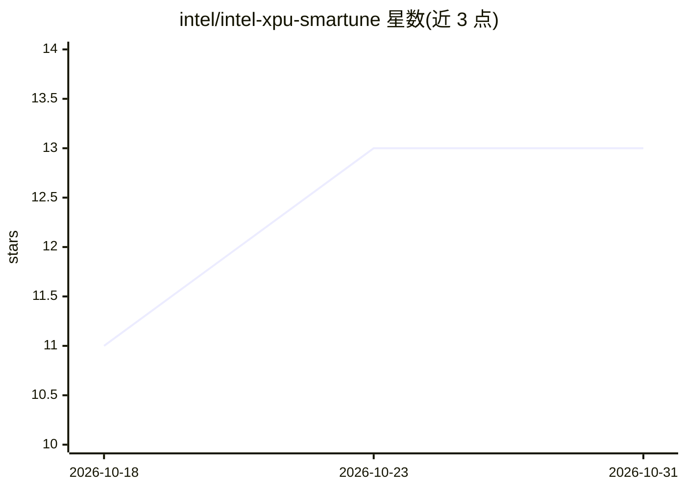

# intel/intel-xpu-smartune

⭐ 13 · Python · Apache-2.0 · 推送 2026-10-30 · [GitHub](https://github.com/intel/intel-xpu-smartune) · 组织维护

**AI NAS 平台资源治理与调优工具：监控压力、限流应用、基准测试**

面向 AI NAS 的平台工具集合，以浏览器仪表盘提供实时监控（CPU/内存/磁盘/网络/Intel GPU/NPU）、基于 PSI 的压力评估、cgroup 应用限流（压力时自动限制低优先级应用，缓解后逐步恢复）、诊断时间线与可导出报告，并可下载 AI 模型在本机用 OpenVINO/GenAI 做基准测试与对比。适用于在同一硬件上并发运行 AI 推理、转码、备份与文件共享的场景。源码运行方式为脚本启动后端与前端仪表盘，文档另提供 systemd 服务与 Debian 包安装。

## 筛选速览

| 维度 | 判定 | 备注 |
|---|---|---|
| AI 角色 | `ai-ecosystem` | LLM/agent 周边工具 |
| 许可风险 | `permissive` | Apache-2.0 |
| 部署形态 | `None` |  |
| 模型依赖 | — | README 未给出锁定关系 |
| 硬件要求 | — | 无带数字的原话,不猜 |
| 安装摩擦 | `low` | 无编译、无系统依赖或容器化 |
| 成熟度 | — | 结构信号不足 |

## 能力要点

- PSI 压力监测与低/中/高/临界分级，指名繁忙磁盘或网卡
- 压力期间经 cgroup 自动限制低优先级应用的 CPU/内存/磁盘/网络，缓解后逐步恢复，无需重启应用
- 下载 AI 模型并在本机用 OpenVINO/GenAI 基准测试，多轮对比
- 诊断时间线、告警、自定义规则与可导出报告

## 适用场景

- 我的 NAS 上 AI 推理和转码/备份抢资源，想自动压住后台任务保关键应用
- 在同一台机器上跑多个模型并对比负载对推理性能的影响
- 统一面板查看整机与每进程的资源使用及长期趋势

## 场景标签

`模型评测` · 领域:评测与运维

## 证据(README 行号)

> L13: Intel XPU SmarTune is a collection of platform tools and services designed to
> L21: actually care about. SmarTune measures that pressure, throttles the
> L40: - Download AI models and benchmark them on this machine (OpenVINO / GenAI)

## 星数曲线

2026-10-18 11 → 2026-10-31 13（+2）

---
*卡片 v1 · prompt 1.4 · 生成 2026-10-31 · 置信度 high · 依据 README sha `28c6ed33a59c` · [字段定义](../../DATASET.md)*
