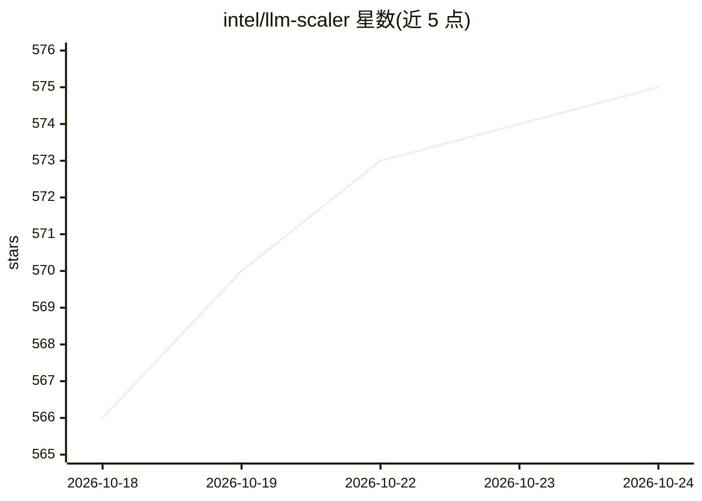

# intel/llm-scaler

⭐ 576 · C++ · Apache-2.0 · 推送 2026-10-23 · [GitHub](https://github.com/intel/llm-scaler) · 组织维护

**面向 Intel Arc Pro B60/B70 GPU 的 GenAI 推理与生成服务方案**

Intel 维护的 GenAI 解决方案，以 Docker 镜像形式在 Intel Arc Pro B60/B70 GPU 上运行文本生成与多模态生成负载。包含两条产品线：llm-scaler-vllm 基于 vLLM 提供文本/多模态/嵌入/重排模型服务，支持 INT4/FP8 在线量化、张量/流水线/数据并行；llm-scaler-omni（标注 experimental）通过 ComfyUI 与 SGLang Diffusion/Xinference 提供图像、视频、音频、3D 生成，含 OpenAI API 兼容服务。支持模型列表覆盖 Qwen、DeepSeek、GLM 等系列，限制是硬件绑定特定 GPU 型号。

## 筛选速览

| 维度 | 判定 | 备注 |
|---|---|---|
| AI 角色 | `ai-ecosystem` | LLM/agent 周边工具 |
| 许可风险 | `permissive` | Apache-2.0 |
| 部署形态 | `library` | 以包/库形式分发 |
| 模型依赖 | local-ok | 支持本地模型 |
| 硬件要求 | — | 无带数字的原话,不猜 |
| 安装摩擦 | `low` | 无编译、无系统依赖或容器化 |
| 成熟度 | `idea` | |

## 能力要点

- 基于 vLLM 的文本/多模态服务，支持 INT4/FP8 在线量化与张量/流水线/数据并行
- Omni 模式经 ComfyUI/SGLang Diffusion/Xinference 提供图像/视频/音频/3D 生成
- 提供 OpenAI API 兼容的图像生成与语音服务端点
- 以 Docker 镜像发布（llm-scaler-vllm / llm-scaler-omni）

## 适用场景

- 在 Intel Arc Pro B60/B70 GPU 上部署文本与多模态模型推理服务
- 通过 ComfyUI 工作流运行图像/视频/3D 生成
- 以 OpenAI API 兼容方式提供图像生成与文本转语音服务

## 场景标签

`推理引擎` `模型量化` `图像生成` · 领域:内容生成

## 证据(README 行号)

> L3: LLM Scaler is an GenAI solution for text generation, image generation, video generation etc. running on Intel® Arc™ 
> L34: `llm-scaler-vllm` supports running text generation models using vLLM, featuring:
> L143: `llm-scaler-omni` supports running image/voice/video generation etc., featuring `Omni Studio` mode (using ComfyUI)

## 星数曲线

2026-10-18 566 → 2026-10-24 575（+9）

---
*卡片 v1 · prompt 1.4 · 生成 2026-10-21 · 置信度 mid · 依据 README sha `40c22c3b6b13` · [字段定义](../../DATASET.md)*
