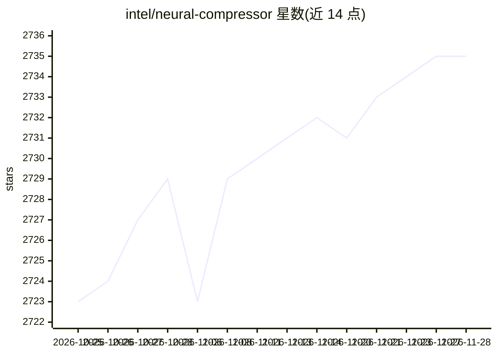

# intel/neural-compressor

⭐ 2,735 · Python · Apache-2.0 · 推送 2026-11-27 · [GitHub](https://github.com/intel/neural-compressor) · [官网](https://intel.github.io/neural-compressor/) · 组织维护

**面向深度学习开发者的模型量化与压缩 Python 库**

Intel 开源的 Python 库，在 PyTorch 与 JAX 框架上提供静态/动态量化、SmoothQuant、Weight-Only 量化、量化感知训练、混合精度等压缩技术，并通过 AutoRound 集成支持 LLM 与 VLM 的低比特量化（INT8/FP8/MXFP8/INT4/MXFP4/NVFP4）。硬件覆盖 Intel Gaudi、Core Ultra、Xeon、GPU Flex/Max 系列（充分测试），AMD/ARM CPU 与 NVIDIA GPU 为有限测试。通过 pypi 安装，Gaudi 场景提供配套 Docker 镜像。

## 筛选速览

| 维度 | 判定 | 备注 |
|---|---|---|
| AI 角色 | `ai-native` | 本体是模型或模型工具 |
| 许可风险 | `permissive` | Apache-2.0 |
| 部署形态 | `self-host` | docker 或自建部署 |
| 模型依赖 | — | README 未给出锁定关系 |
| 硬件要求 | — | 无带数字的原话,不猜 |
| 安装摩擦 | `low` | 无编译、无系统依赖或容器化 |
| 成熟度 | — | 结构信号不足 |

## 能力要点

- 支持 Static/Dynamic/SmoothQuant/Weight-Only/QAT/Mixed Precision 等量化技术
- 通过 AutoRound 集成对 LLM/VLM（LLaMA、Qwen、DeepSeek、Flux 等）做低比特量化
- 覆盖 Intel Gaudi/Core Ultra/Xeon/GPU 系列硬件，AMD/ARM/NVIDIA 有限测试
- 提供 PyTorch 与 JAX 两套 Extension API 及 Auto Tune 模块

## 适用场景

- 把 LLM 量化到 INT4/FP8 以降低部署开销
- 在 Intel Gaudi/Xeon 环境做模型低精度推理
- 对视觉/语言模型做训练后量化或量化感知训练

## 场景标签

`模型量化` · 领域:训练与推理

## 证据(README 行号)

> L2:  An open-source Python library supporting popular model compression techniques on mainstream deep learning framework
> L14: Intel® Neural Compressor aims to provide popular model compression techniques such as Static Quantization, Dynamic 
> L16: * Support advanced quantization of Large Language Models (LLMs) and Vision-Language Models (VLMs) such as LLaMA, Qw

## 星数曲线

2026-10-25 2,723 → 2026-11-28 2,735（+12）

---
*卡片 v1 · prompt 1.4 · 生成 2026-11-26 · 置信度 high · 依据 README sha `435f6c48adb6` · [字段定义](../../DATASET.md)*
