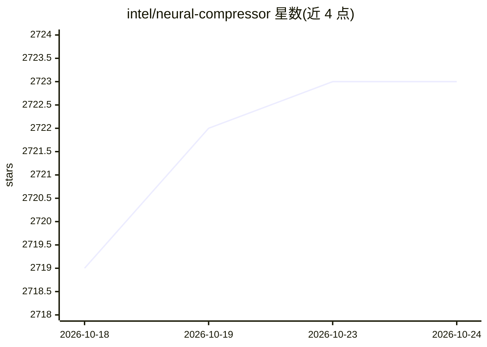

# intel/neural-compressor

⭐ 2,723 · Python · Apache-2.0 · 推送 2026-10-24 · [GitHub](https://github.com/intel/neural-compressor) · [官网](https://intel.github.io/neural-compressor/) · 组织维护

**Intel 开源的深度学习模型压缩库：量化/剪枝/蒸馏**

Intel 维护的 Python 库，在 PyTorch、TensorFlow、JAX 及 ONNX Runtime 上提供静态/动态量化、SmoothQuant、Weight-Only 量化、QAT、混合精度、剪枝与知识蒸馏等压缩技术；通过集成 AutoRound 支持大语言模型与视觉语言模型（LLaMA、Qwen、DeepSeek 等）的低比特量化（INT8/FP8/INT4 等）。广泛测试覆盖 Intel Gaudi、Core Ultra、Xeon、数据中心 GPU 等硬件，对 AMD CPU、ARM CPU、NVIDIA GPU 提供有限测试支持。提供 pypi 分包安装与 Docker 镜像运行方式。

## 筛选速览

| 维度 | 判定 | 备注 |
|---|---|---|
| AI 角色 | `ai-ecosystem` | LLM/agent 周边工具 |
| 许可风险 | `permissive` | Apache-2.0 |
| 部署形态 | `self-host` | docker 或自建部署 |
| 模型依赖 | — | README 未给出锁定关系 |
| 硬件要求 | — | 无带数字的原话,不猜 |
| 安装摩擦 | `low` | 无编译、无系统依赖或容器化 |
| 成熟度 | — | 结构信号不足 |

## 能力要点

- 静态/动态量化、SmoothQuant、Weight-Only、QAT、混合精度、剪枝、蒸馏
- 经 AutoRound 支持 LLM/VLM 低比特量化（LLaMA、Qwen、DeepSeek 等）
- 覆盖 PyTorch/TensorFlow/JAX 三套框架扩展 API
- 广泛测试 Intel Gaudi/Core Ultra/Xeon/数据中心 GPU，有限测试 AMD/ARM CPU 与 NVIDIA GPU

## 适用场景

- 对 LLM 做 INT8/FP8/INT4 等低比特量化以压缩部署
- 在 Intel 硬件上做模型量化与精度调优
- 对 TensorFlow/PyTorch 模型做剪枝与知识蒸馏

## 场景标签

`模型量化` · 领域:训练与推理

## 证据(README 行号)

> L2:  An open-source Python library supporting popular model compression techniques on mainstream deep learning framework
> L12: Intel® Neural Compressor aims to provide popular model compression techniques such as Static Quantization, Dynamic 

## 星数曲线

2026-10-18 2,719 → 2026-10-24 2,723（+4）

---
*卡片 v1 · prompt 1.4 · 生成 2026-10-21 · 置信度 high · 依据 README sha `2ce951df719c` · [字段定义](../../DATASET.md)*
