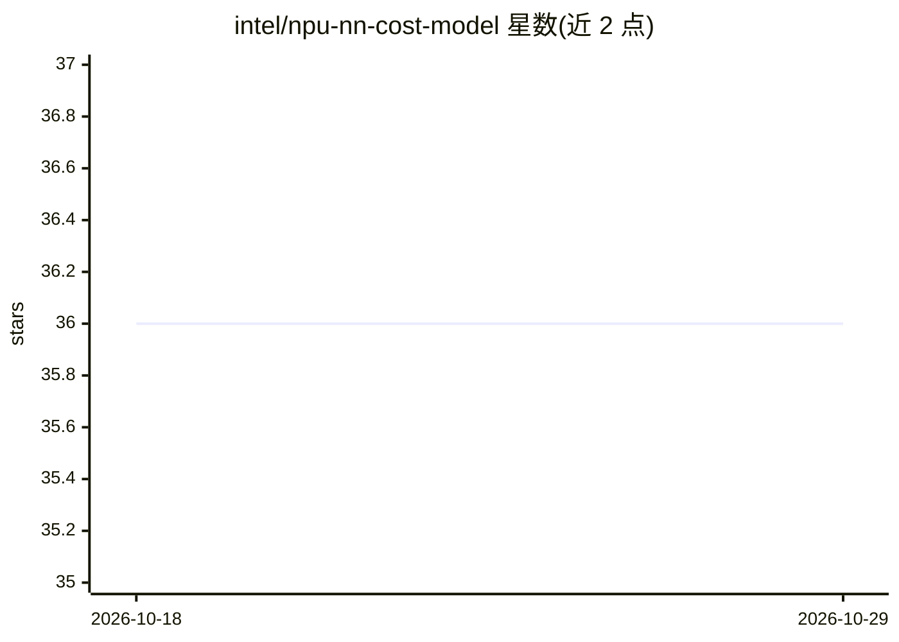

# intel/npu-nn-cost-model

⭐ 36 · C++ · Apache-2.0 · 推送 2026-10-21 · [GitHub](https://github.com/intel/npu-nn-cost-model) · 组织维护

**预测神经网络工作负载在 Intel NPU 上运行开销的代价模型库**

面向 Intel VPU/NPU 设备的神经网络性能代价模型 C++/Python 库：输入层描述（如卷积的形状与切分策略），输出预测的运行开销，用于编译器与工作负载模式选择。核心是基于训练神经网络的学习型代价提供器，另含理论模型、实测 LUT（Oracle）与可通过 HTTP 查询的 profiling 服务共四类可插拔代价提供器，运行时按设备类型选择。需 GCC>9 用 CMake 编译，BLAS 可选 MKL 或 OpenBLAS；README 列出 NPU2.7/4.0 各配置的训练覆盖限制与已知误差。

## 筛选速览

| 维度 | 判定 | 备注 |
|---|---|---|
| AI 角色 | `ai-ecosystem` | LLM/agent 周边工具 |
| 许可风险 | `permissive` | Apache-2.0 |
| 部署形态 | `library` | 以包/库形式分发 |
| 模型依赖 | — | README 未给出锁定关系 |
| 硬件要求 | — | 无带数字的原话,不猜 |
| 安装摩擦 | `medium` | 含编译或系统依赖之一 |
| 成熟度 | — | 结构信号不足 |

## 能力要点

- NN 学习型代价模型，支持 C++ 与 Python（pip 从源码编译绑定）两类接口
- 四类可插拔代价提供器：NN/理论/Oracle LUT/HTTP profiling 服务，运行时按设备选择
- 支持 NPU2.0/2.7/4.0 工作负载查询与 MPE 模式、切分策略选择示例
- 附论文（arXiv:2205.04586）说明模型构建与训练

## 适用场景

- 编译器或调度器在切分/模式选择时评估候选工作负载开销
- 为 NPU2.7/4.0 工作负载查询预测运行时间
- 通过 profiling 服务获取实测性能作对照

## 场景标签

 · 领域:AI 编译器/硬件性能建模

## 证据(README 行号)

> L1: # VPUNN cost model
> L3: A NN-Based Cost Model for VPU Devices. For additional information about model setup and training, please refer this 
> L193: The cost model is designed to be extensible. The cost providers are the classes that implement the cost model for 

## 星数曲线

2026-10-18 36 → 2026-10-29 36（+0）

---
*卡片 v1 · prompt 1.4 · 生成 2026-10-25 · 置信度 mid · 依据 README sha `fa8d37cd652d` · [字段定义](../../DATASET.md)*
