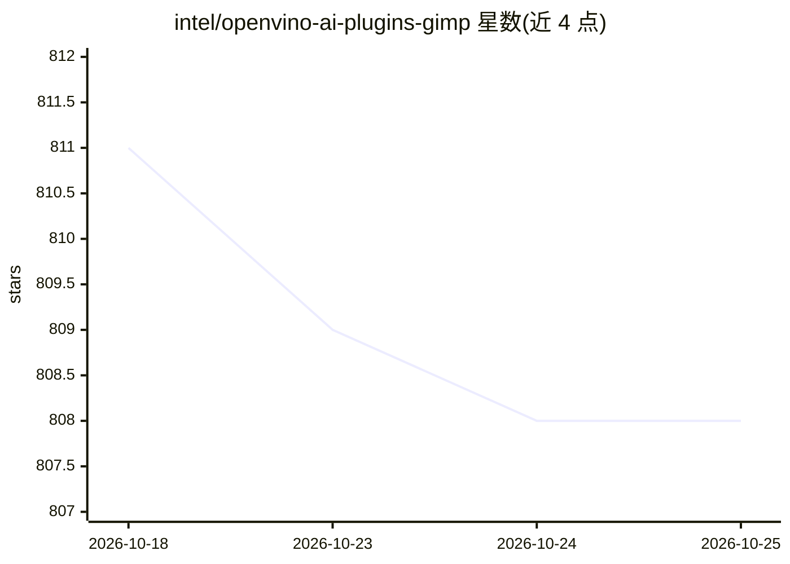

# intel/openvino-ai-plugins-gimp

⭐ 808 · Python · Apache-2.0 · 推送 2026-10-12 · [GitHub](https://github.com/intel/openvino-ai-plugins-gimp) · 组织维护

**给 GIMP 用户的 OpenVINO AI 插件集：图像生成/超分/语义分割**

面向 GIMP 3 的 Python 插件集合，基于 OpenVINO 在 Intel 设备（CPU/GPU/NPU）上推理，为图像编辑流程添加 AI 功能。插件包括：Stable Diffusion 文生图/图生图/局部重绘（SD 1.5、SDXL、SD 3.x、ControlNet 变体）、基于 LCM/ADD 的 FastSD 快速生成、语义分割与超分辨率。作为在 GIMP 中使用 OpenVINO 推理的参考代码提供。Windows/Linux 各有安装指南，Linux 建议 GIMP 3 源码编译、不支持 Flatpak；首次加载模型需数分钟，模型运行时下载。

## 筛选速览

| 维度 | 判定 | 备注 |
|---|---|---|
| AI 角色 | `ai-native` | 本体是模型或模型工具 |
| 许可风险 | `permissive` | Apache-2.0 |
| 部署形态 | `None` |  |
| 模型依赖 | — | README 未给出锁定关系 |
| 硬件要求 | — | 无带数字的原话,不猜 |
| 安装摩擦 | `low` | 无编译、无系统依赖或容器化 |
| 成熟度 | — | 结构信号不足 |

## 能力要点

- Stable Diffusion 系列插件覆盖 SD1.5/SDXL/SD3.x、Inpainting 与三种 ControlNet
- FastSD 基于 LCM/对抗蒸馏，支持 CPU/GPU/NPU 推理
- 超分辨率与语义分割插件
- 面向 Intel 设备的 OpenVINO 推理，含 int8 模型与 NPU Power Mode

## 适用场景

- 在 GIMP 内直接做文生图/图生图/局部重绘
- 用 ControlNet 按姿势/边缘/涂鸦控制生成结果
- 对图像执行超分辨率或语义分割

## 场景标签

`图像生成` `图像视频处理` · 领域:内容生成

## 证据(README 行号)

> L31: 1. Provides a set of OpenVINO™ based plugins that add AI features to GIMP.
> L117: FastSD is a faster version of stable diffusion based on Latent Consistency Models and Adversarial Diffusion Distil

## 星数曲线

2026-10-18 811 → 2026-10-25 808（-3）

---
*卡片 v1 · prompt 1.4 · 生成 2026-10-21 · 置信度 high · 依据 README sha `bbada95ae4d5` · [字段定义](../../DATASET.md)*
