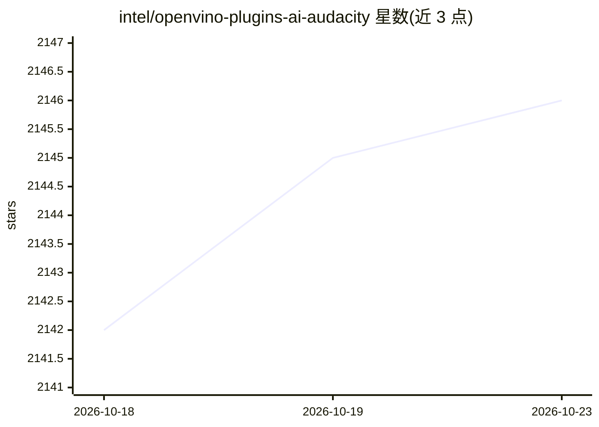

# intel/openvino-plugins-ai-audacity

⭐ 2,146 · C++ · GPL-3.0 · 推送 2026-10-19 · [GitHub](https://github.com/intel/openvino-plugins-ai-audacity) · 组织维护

**给 Audacity 用户的本地 AI 音频效果、生成与分析插件集**

Intel 维护的 Audacity 插件集，提供六类 AI 音频功能：音轨分离（Demucs v4）、降噪（DeepFilterNet2/3 等）、MusicGen 音乐生成与续写、Whisper 转录/翻译、音频超分辨率。所有 AI 功能通过 OpenVINO 在本机 CPU/GPU/NPU 上运行，无需联网。以 Windows 安装包形式分发，Linux 需按构建说明从源码编译。模型管线多由 Python/PyTorch 移植为 C++/OpenVINO IR。

## 筛选速览

| 维度 | 判定 | 备注 |
|---|---|---|
| AI 角色 | `ai-native` | 本体是模型或模型工具 |
| 许可风险 | `viral` | GPL-3.0 |
| 部署形态 | `None` |  |
| 模型依赖 | local-ok | 支持本地模型 |
| 硬件要求 | — | 无带数字的原话,不猜 |
| 安装摩擦 | `low` | 无编译、无系统依赖或容器化 |
| 成熟度 | — | 结构信号不足 |

## 能力要点

- 音乐分离、降噪、MusicGen 音乐生成、Whisper 转录、音频超分辨率等 6 类 AI 功能
- 100% 本地运行，通过 OpenVINO 支持 CPU/GPU/NPU 加速器
- Whisper 转录使用 whisper.cpp（OpenVINO 后端）

## 适用场景

- 在 Audacity 中把音轨拆分为鼓/贝斯/人声/其他分轨
- 离线转录或翻译选中的语音片段
- 本地生成或续写音乐片段

## 场景标签

`语音识别` · 领域:感知与多模态

## 证据(README 行号)

> L5: A set of AI-enabled effects, generators, and analyzers for Audacity®. These AI features run 100% locally on your PC 
> L7: - **Music Separation**:musical_note: -- Separate a mono or stereo track into individual stems -- Drums, Bass, Vocals

## 星数曲线

2026-10-18 2,142 → 2026-10-23 2,146（+4）

---
*卡片 v1 · prompt 1.4 · 生成 2026-10-21 · 置信度 high · 依据 README sha `9d8cebb4c9c9` · [字段定义](../../DATASET.md)*
