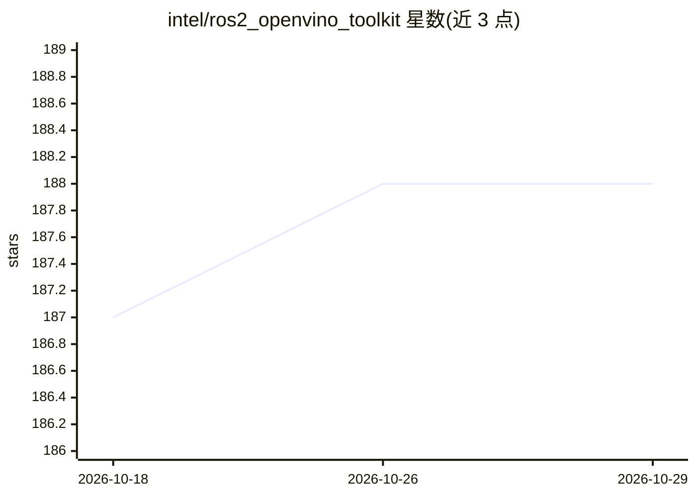

# intel/ros2_openvino_toolkit

⭐ 188 · C++ · Apache-2.0 · 推送 2026-06-10 · [GitHub](https://github.com/intel/ros2_openvino_toolkit) · 组织维护

**将 Intel OpenVINO 集成到 ROS 2 的深度学习视觉推理运行时框架**

Intel 维护的 ROS 2 工具与库集合，把 Intel OpenVINO 工具包封装为 ROS 适配的神经网络运行时框架，在 Intel 处理器与加速器上部署计算机视觉推理。内置 Pipeline/Pipeline Manager/参数管理器机制，通过 yaml 配置组装推理管线；支持 9 类推理功能（目标检测、人脸检测、年龄性别/情绪识别、头姿估计、分割、行人重识别、车辆属性与车牌检测）。输入支持 USB 相机、RealSense、ROS 图像话题、图片/视频文件与 RTSP 流；结果以 ROS Topic、Service、RViz 与 OpenCV 窗口输出。限定 Ubuntu 与指定 ROS 2/OpenVINO 版本组合，硬件要求 Intel 处理器平台。

## 筛选速览

| 维度 | 判定 | 备注 |
|---|---|---|
| AI 角色 | `ai-ecosystem` | LLM/agent 周边工具 |
| 许可风险 | `permissive` | Apache-2.0 |
| 部署形态 | `None` |  |
| 模型依赖 | — | README 未给出锁定关系 |
| 硬件要求 | — | 无带数字的原话,不猜 |
| 安装摩擦 | `low` | 无编译、无系统依赖或容器化 |
| 成熟度 | — | 结构信号不足 |

## 能力要点

- Pipeline 生命周期管理与 yaml 配置驱动的推理管线组装
- 9 类视觉推理功能，覆盖人脸/情绪/年龄性别/头姿/分割/行人重识别/车辆与车牌
- 6 种图像输入源：USB 相机、RealSense、ROS 话题、图片、视频、RTSP
- 结果输出支持 ROS Topic、Service 同步查询、RViz 与 OpenCV 窗口

## 适用场景

- 在 ROS 2 机器人系统中接入 OpenVINO 做实时视觉推理
- 通过 ROS Service 同步获取单帧图像的检测结果
- 在 Intel 平台上部署人脸/行人/车辆分析管线并在 RViz 可视化

## 场景标签

`人脸识别` `目标检测` `推理引擎` · 领域:感知与多模态

## 证据(README 行号)

> L44: - **Intel® OpenVINO™ toolkit** provides a ROS-adapted runtime framework of neural network which quickly deploys app
> L52: - **ROS OpenVINO Runtime Framework** is the main body of this repo. It provides key logic implementation for pipeli

## 星数曲线

2026-10-18 187 → 2026-10-29 188（+1）

---
*卡片 v1 · prompt 1.4 · 生成 2026-10-22 · 置信度 high · 依据 README sha `8e9a354e190c` · [字段定义](../../DATASET.md)*
