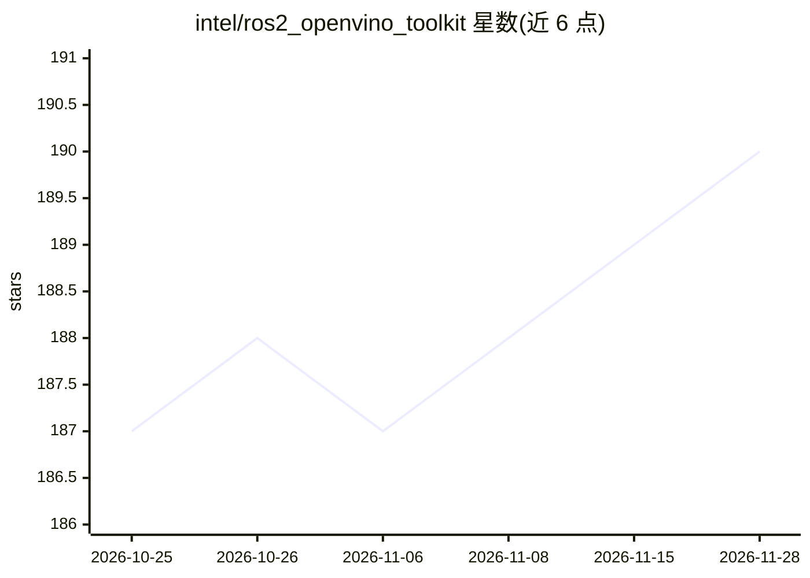

# intel/ros2_openvino_toolkit

⭐ 190 · C++ · Apache-2.0 · 推送 2026-11-23 · [GitHub](https://github.com/intel/ros2_openvino_toolkit) · [官网](https://developer.robotics.intel.com) · 组织维护

**在 ROS 2 中集成 OpenVINO、在 Intel 硬件上运行视觉推理的工具集**

该仓库提供一组工具与库，将 Intel OpenVINO Toolkit 接入 ROS 2，用于在 Intel 硬件上部署深度学习视觉模型。支持目标检测、人脸检测、年龄性别识别、姿态估计、语义/实例分割、深度估计、行人重识别等 14 类推理功能，输入可来自 USB 相机、ROS 图像话题、图像/视频文件或 RTSP 流，结果以 ROS Topic/Service 及 RViz、CV 窗口输出。依赖 Ubuntu 与对应版本的 ROS 2 发行版及 OpenVINO，通过 Intel APT 安装。

## 筛选速览

| 维度 | 判定 | 备注 |
|---|---|---|
| AI 角色 | `ai-ecosystem` | LLM/agent 周边工具 |
| 许可风险 | `permissive` | Apache-2.0 |
| 部署形态 | `None` |  |
| 模型依赖 | local-ok | 支持本地模型 |
| 硬件要求 | — | 无带数字的原话,不猜 |
| 安装摩擦 | `low` | 无编译、无系统依赖或容器化 |
| 成熟度 | — | 结构信号不足 |

## 能力要点

- 14 类视觉推理功能，含 OBB 旋转框检测与深度估计
- 多种输入源：USB 相机、ROS 图像话题、图像/视频文件、RTSP
- 基于 .yaml 配置的 pipeline 管理与生命周期控制
- 支持 Intel NPU 加速（Core Ultra 处理器）

## 适用场景

- 在 Intel 平台的机器人上运行目标检测与人脸识别视觉管线
- 把相机或 RTSP 视频流接入 ROS 2 推理节点并发布检测结果话题
- 利用 OpenVINO 将 Caffe/TensorFlow/ONNX 等训练模型转换部署到机器人视觉应用

## 场景标签

`人脸识别` `目标检测` `图像视频处理` `推理引擎` · 领域:感知与多模态

## 证据(README 行号)

> L52: - **Intel® OpenVINO™ toolkit** provides a ROS-adapted runtime framework of neural network which quickly deploys app
> L60: - **ROS OpenVINO Runtime Framework** is the main body of this repo. It provides key logic implementation for pipeli

## 星数曲线

2026-10-25 187 → 2026-11-28 190（+3）

---
*卡片 v1 · prompt 1.4 · 生成 2026-11-26 · 置信度 high · 依据 README sha `48da26b851dd` · [字段定义](../../DATASET.md)*
