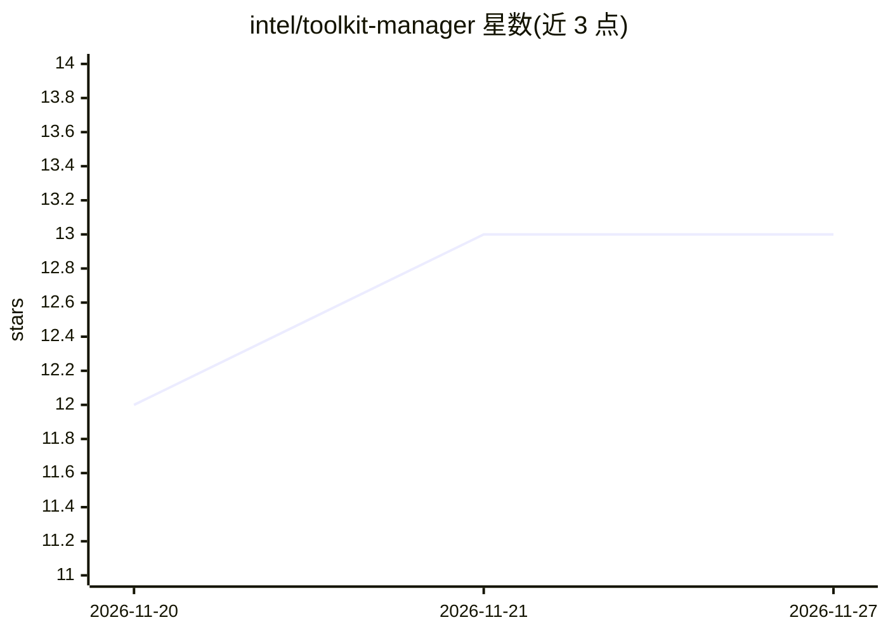

# intel/toolkit-manager

⭐ 13 · Python · Apache-2.0 · 推送 2026-11-26 · [GitHub](https://github.com/intel/toolkit-manager) · 组织维护

**在 Intel Xeon 的 Kubernetes 上一键部署 LLM 推理平台**

面向 Intel® Xeon® 平台的 Kubernetes 部署安装器：单个脚本从裸金属完成集群供给、平台服务（Istio、Envoy 网关、Keycloak 认证、PostgreSQL、可观测性栈）、模型服务（vLLM/OVMS）与 OpenAI 兼容端点配置，可选装 RAG（Chatbot Toolkit）与 Agent（Agent Toolkit）层。要求 Ubuntu 22.04/24.04 或 RHEL/Rocky x86_64、免密 sudo 与网络访问，单节点安装约 15-20 分钟。

## 筛选速览

| 维度 | 判定 | 备注 |
|---|---|---|
| AI 角色 | `ai-ecosystem` | LLM/agent 周边工具 |
| 许可风险 | `permissive` | Apache-2.0 |
| 部署形态 | `None` |  |
| 模型依赖 | local-ok | 支持本地模型 |
| 硬件要求 | — | 无带数字的原话,不猜 |
| 安装摩擦 | `low` | 无编译、无系统依赖或容器化 |
| 成熟度 | — | 结构信号不足 |

## 能力要点

- 单脚本完成 Kubernetes 供给到 AI 网关的四层部署
- OpenAI 兼容 API 端点，兼容现有 OpenAI 客户端
- 内置 Keycloak OIDC 认证与 Grafana/Prometheus/Loki/Tempo 可观测性
- 可选 RAG 与 Agent 工具层（向量库、MCP 网关、LiteLLM 虚拟密钥）

## 适用场景

- 在 Intel Xeon 服务器上从裸金属搭建 LLM 推理端点
- 为团队部署带认证与监控的生产级 AI 平台
- 部署文档摄取、向量检索与聊天界面的完整 RAG 应用
- 为 Agent 应用提供沙箱与受治理的 LLM 网关

## 场景标签

`推理引擎` `MLOps` `RAG` · 领域:知识与检索

## 证据(README 行号)

> L12: > Deploy and connect LLM inference, RAG, and agentic workflows in a customizable Kubernetes-based platform — with a
> L20: A single installer script, `toolkit_manager.sh`, takes bare-metal nodes through Kubernetes provisioning, platform s

## 星数曲线

2026-11-20 12 → 2026-11-27 13（+1）

---
*卡片 v1 · prompt 1.4 · 生成 2026-11-21 · 置信度 high · 依据 README sha `2cb71897296d` · [字段定义](../../DATASET.md)*
