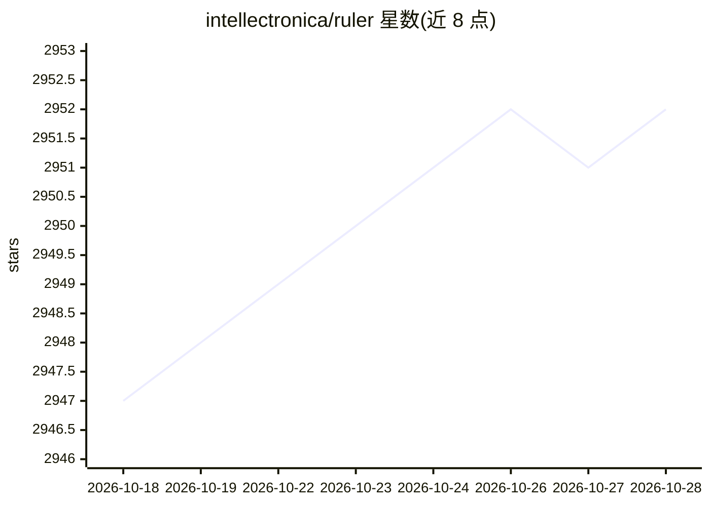

# intellectronica/ruler

⭐ 2,952 · TypeScript · MIT · 推送 2026-10-22 · [GitHub](https://github.com/intellectronica/ruler) · 个人维护

**统一管理并分发 AI 编码助手规则配置的 CLI 工具**

面向使用多种 AI 编码代理（GitHub Copilot、Claude Code、Cursor、Aider 等 30 余种）的开发者与团队：在 .ruler/ 目录以 Markdown 集中存放指令规则，通过 ruler apply 自动分发写入各代理对应的配置文件，并同步 MCP server 配置、自动更新 .gitignore、支持嵌套目录加载与按代理定向输出；ruler revert 可从备份还原或移除生成文件。以 npm 包与 CLI 提供，需 Node.js 20+。自述为 Beta Research Preview，嵌套模式为实验特性。

## 筛选速览

| 维度 | 判定 | 备注 |
|---|---|---|
| AI 角色 | `ai-ecosystem` | LLM/agent 周边工具 |
| 许可风险 | `permissive` | MIT |
| 部署形态 | `library` | 以包/库形式分发 |
| 模型依赖 | — | README 未给出锁定关系 |
| 硬件要求 | — | 无带数字的原话,不猜 |
| 安装摩擦 | `low` | 无编译、无系统依赖或容器化 |
| 成熟度 | `idea` | |

## 能力要点

- 单一 .ruler/ 目录集中管理规则，自动分发给 30 余种 AI 编码代理
- 支持 MCP server 配置分发与 .gitignore 自动维护
- 嵌套规则加载（--nested）适配 monorepo 等多组件项目
- ruler revert 从 .bak 备份还原或清除生成的配置

## 适用场景

- 团队在多个 AI 编码工具间保持一致的编码规则
- monorepo 中为不同子项目下发各自的上下文指令
- 统一管理各代理的 MCP server 配置

## 场景标签

`提示工程` · 领域:Agent 开发

## 证据(README 行号)

> L23: Managing instructions across multiple AI coding tools becomes complex as your team grows. Different agents (GitHub 
> L37: - **Automatic Distribution**: Ruler applies these rules to configuration files of supported AI agents
> L45: |Agent|Rules File(s)|MCP Configuration / Notes|Skills Support / Location|Subagents Support / Location|

## 星数曲线

2026-10-18 2,947 → 2026-10-28 2,952（+5）

---
*卡片 v1 · prompt 1.4 · 生成 2026-10-21 · 置信度 high · 依据 README sha `69223fc9a0fc` · [字段定义](../../DATASET.md)*
