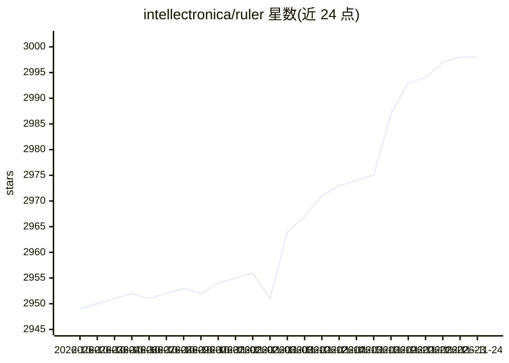

# intellectronica/ruler

⭐ 2,999 · TypeScript · MIT · 推送 2026-11-22 · [GitHub](https://github.com/intellectronica/ruler) · 个人维护

**为多款 AI 编码助手集中管理并分发指令的 CLI 工具**

把项目的 AI 编码指令集中放在 `.ruler/` 目录的 Markdown 文件中，通过 `ruler apply` 命令自动分发到 30 余款 AI 编码代理各自的配置文件（如 CLAUDE.md、AGENTS.md、.cursor/mcp.json 等），并提供 `ruler revert` 回滚。支持嵌套规则加载（实验性）适配 monorepo、MCP 服务器配置分发、.gitignore 自动更新、备份文件与 dry-run 预览。以 npm 包分发，需 Node.js ^20.19.0 以上。README 标注为 Beta Research Preview。

## 筛选速览

| 维度 | 判定 | 备注 |
|---|---|---|
| AI 角色 | `ai-ecosystem` | LLM/agent 周边工具 |
| 许可风险 | `permissive` | MIT |
| 部署形态 | `library` | 以包/库形式分发 |
| 模型依赖 | locked-api |  |
| 硬件要求 | — | 无带数字的原话,不猜 |
| 安装摩擦 | `low` | 无编译、无系统依赖或容器化 |
| 成熟度 | `idea` | |

## 能力要点

- 单一 `.ruler/` 目录作为所有 AI 代理指令的单一来源
- 支持 30 余款编码代理的规则文件与 MCP 配置分发
- 嵌套规则加载（--nested，实验性）适配复杂项目结构
- 提供 revert 命令基于 .bak 备份回滚变更

## 适用场景

- 团队在多个 AI 编码工具间保持统一的编码规范指令
- monorepo 中为不同服务维护上下文相关的代理规则
- 统一管理各编码代理的 MCP 服务器配置

## 场景标签

 · 领域:开发者工具/AI 编码工作流

## 证据(README 行号)

> L31: Ruler solves this by providing a **single source of truth** for all your AI agent instructions, automatically distr
> L37: - **Automatic Distribution**: Ruler applies these rules to configuration files of supported AI agents
> L43: ## Supported AI Agents

## 星数曲线

2026-10-22 2,949 → 2026-11-24 2,998（+49）

---
*卡片 v1 · prompt 1.4 · 生成 2026-11-23 · 置信度 high · 依据 README sha `80d4747a55f0` · [字段定义](../../DATASET.md)*
