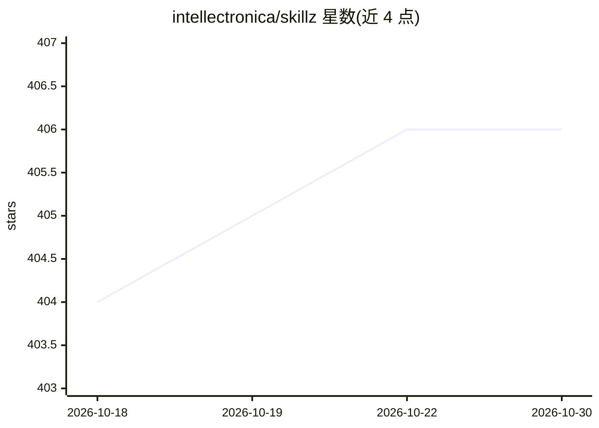

# intellectronica/skillz

⭐ 406 · Python · MIT · 推送 2026-01-30 · [GitHub](https://github.com/intellectronica/skillz) · [官网](https://okigu.com/skillz) · 个人维护

**MCP 服务器：让任意 MCP 客户端加载 Claude 风格技能为可调用工具**

Skillz 是一个 MCP 服务器（shim），把 Claude 风格的技能（SKILL.md 及附带资源）转换为任何 MCP 客户端（Codex、Copilot、Cursor 等）可调用的工具：发现技能、暴露其编写的指令与资源，并可运行打包的辅助脚本。技能可存放于目录或 .zip/.skill 压缩包，支持嵌套子目录布局（Claude Code 仅支持平铺布局）。默认根目录 ~/.skillz，提供 stdio/http/sse 三种传输与 CLI 选项；另提供 Docker 镜像用于隔离运行和 Gemini CLI 扩展。README 自述为实验性概念验证，提示技能应视为不受信任代码并在沙箱/容器中运行。

## 筛选速览

| 维度 | 判定 | 备注 |
|---|---|---|
| AI 角色 | `ai-ecosystem` | LLM/agent 周边工具 |
| 许可风险 | `permissive` | MIT |
| 部署形态 | `library` | 以包/库形式分发 |
| 模型依赖 | — | README 未给出锁定关系 |
| 硬件要求 | — | 无带数字的原话,不猜 |
| 安装摩擦 | `low` | 无编译、无系统依赖或容器化 |
| 成熟度 | `idea` | |

## 能力要点

- 将 SKILL.md 技能暴露为任意 MCP 客户端的可调用工具
- 技能可按目录或 .zip/.skill 压缩包组织，支持嵌套子目录
- 提供 Docker 镜像（intellectronica/skillz）用于隔离运行
- 支持 stdio/http/sse 三种 FastMCP 传输与 --list-skills 预检

## 适用场景

- 在非 Claude 的 agent（Codex/Copilot/Cursor 等）中使用已有的 Claude 风格技能
- 用 Docker 容器隔离运行不受信任的第三方技能
- 复用同一技能目录同时兼容 Skillz 与 Claude Code（平铺布局）

## 场景标签

`Agent 框架` · 领域:Agent 开发

## 证据(README 行号)

> L10: **Skillz** is an MCP server that turns Claude-style skills _(`SKILL.md` plus optional resources)_ into callable too
> L3: ## 👌 **Use _skills_ in any agent** _(Codex, Copilot, Cursor, etc...)_

## 星数曲线

2026-10-18 404 → 2026-10-30 406（+2）

---
*卡片 v1 · prompt 1.4 · 生成 2026-10-21 · 置信度 high · 依据 README sha `6bcbcb4d6438` · [字段定义](../../DATASET.md)*
