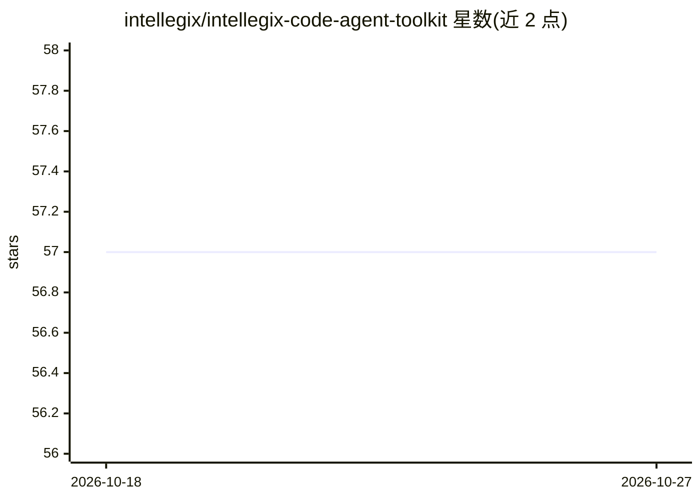

# intellegix/intellegix-code-agent-toolkit

⭐ 57 · Python · MIT · 推送 2026-10-19 · [GitHub](https://github.com/intellegix/intellegix-code-agent-toolkit) · 组织维护

**Claude Code CLI 的配置工具集：自主循环驱动、编排与治理命令**

面向 Claude Code CLI 用户的模块化配置系统：包含自主循环驱动器（会话连续性、预算与停滞检测、模型感知缩放）、三个编排器命令（新项目引导/单循环/基于 git worktree 的多 agent 并行）、31 个自定义斜杠命令、基于 Playwright 与浏览器会话的 Perplexity 多模型 council 自动化、MCP 浏览器桥接 Chrome 扩展、7 层前端 E2E 测试与项目组合治理。安装方式为 git clone 到 ~/.claude 配置目录，需 Python 3.11+ 与 Node.js 18+，研究功能依赖 Perplexity 订阅（可选）。

## 筛选速览

| 维度 | 判定 | 备注 |
|---|---|---|
| AI 角色 | `ai-ecosystem` | LLM/agent 周边工具 |
| 许可风险 | `permissive` | MIT |
| 部署形态 | `desktop` | 安装包/桌面程序 |
| 模型依赖 | — | README 未给出锁定关系 |
| 硬件要求 | — | 无带数字的原话,不猜 |
| 安装摩擦 | `low` | 无编译、无系统依赖或容器化 |
| 成熟度 | — | 结构信号不足 |

## 能力要点

- 自主循环驱动器：NDJSON 流式事件、预算执行、模型回退与停滞检测
- 三个编排器命令，含基于 git worktree 的多 agent 并行执行
- 通过 MCP 浏览器桥接与缓存的会话 Cookie 调用 Perplexity 多模型 council（无需 API key）
- 7 层浏览器端到端前端测试（含可访问性与性能层）

## 适用场景

- 让 Claude Code 在自主循环中长时执行多阶段项目并人工审计进度
- 多 agent 并行开发与项目编排
- 通过多模型 council 获取交叉研究结果

## 场景标签

`多智能体` `浏览器自动化` `编码 Agent` · 领域:Agent 开发

## 证据(README 行号)

> L8: A modular configuration system for Claude Code CLI. Includes an automated loop driver, multi-agent parallel orchestr
> L111: Runs Claude Code CLI in autonomous loops with NDJSON streaming, session continuity, and safety guardrails.
> L136: Run `loop_driver.py` from a Claude Code session or a separate terminal. The loop spawns Claude Code CLI as a worke

## 星数曲线

2026-10-18 57 → 2026-10-27 57（+0）

---
*卡片 v1 · prompt 1.4 · 生成 2026-10-24 · 置信度 mid · 依据 README sha `4d73d1a71cd7` · [字段定义](../../DATASET.md)*
