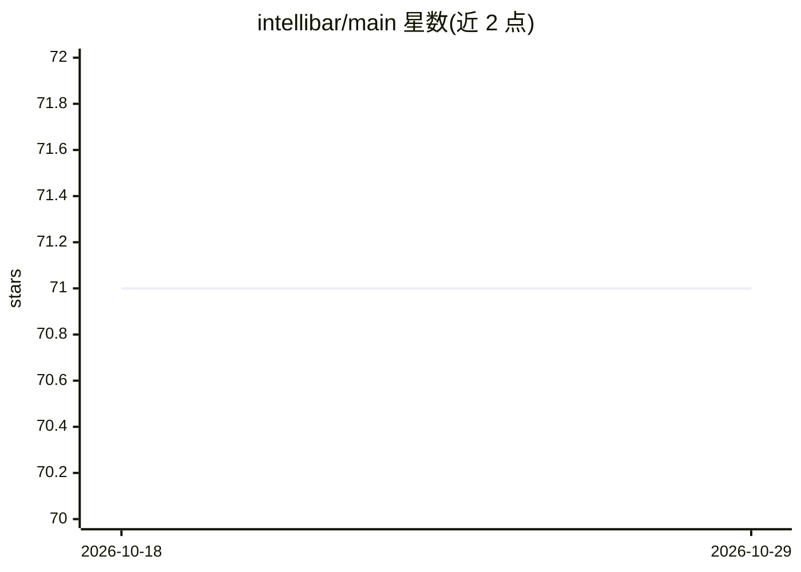

# intellibar/main

⭐ 71 · 推送 2026-01-13 · [GitHub](https://github.com/intellibar/main) · [官网](https://intellibar.app/) · 组织维护

**Mac 平台 AI 助手应用 IntelliBar 的官方资源仓库**

该仓库是 Mac 平台 AI 助手应用 IntelliBar 的配套资源仓库，不包含应用源代码或安装说明，仅提供 Issues 用于报告问题、Discussions 用于功能请求与交流、Releases 用于查看版本变更记录。面向 IntelliBar 的用户与关注者。README 未说明应用的具体功能、模型接入方式或安装途径。

## 筛选速览

| 维度 | 判定 | 备注 |
|---|---|---|
| AI 角色 | `ai-native` | 本体是模型或模型工具 |
| 许可风险 | `none` | — |
| 部署形态 | `None` |  |
| 模型依赖 | — | README 未给出锁定关系 |
| 硬件要求 | — | 无带数字的原话,不猜 |
| 安装摩擦 | `low` | 无编译、无系统依赖或容器化 |
| 成熟度 | — | 结构信号不足 |

## 能力要点

- 用于报告应用问题的 Issues 入口
- 用于功能请求与交流的 Discussions 入口
- Releases 记录应用版本变更

## 适用场景

- 作为 IntelliBar 用户报告应用问题
- 提交功能请求或参与用户讨论
- 查看应用的版本更新记录

## 场景标签

`AI 助手` · 领域:对话与助手

## 证据(README 行号)

> L1: Resources for the AI assistant app for Mac, IntelliBar.

## 星数曲线

2026-10-18 71 → 2026-10-29 71（+0）

---
*卡片 v1 · prompt 1.4 · 生成 2026-10-24 · 置信度 low · 依据 README sha `4aac222c8ae1` · [字段定义](../../DATASET.md)*
