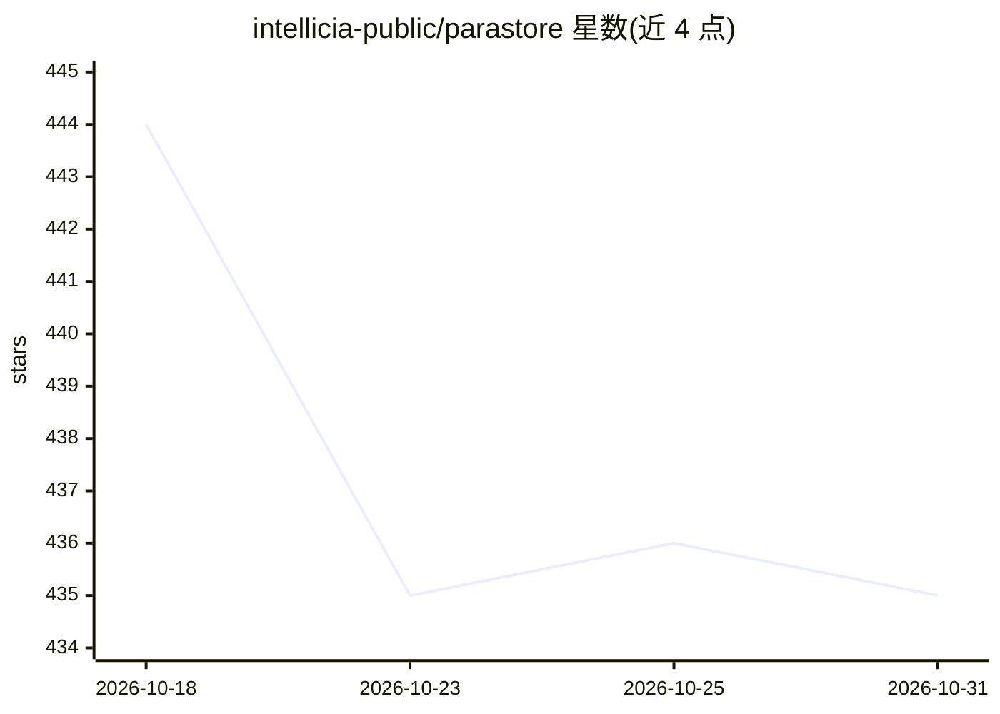

# intellicia-public/parastore

⭐ 435 · TypeScript · MIT · 推送 2026-05-21 · [GitHub](https://github.com/intellicia-public/parastore) · 组织维护

**等距 3D 零售沙盒：LLM 生成虚拟顾客模拟逛店消费**

由 intellicia 开源的零售空间模拟原型：基于门店地址与一句话客群描述，LLM 分析商圈并生成带画像的合成消费者，用户在等距网格编辑器中绘制货架、冷柜、收银台与动线，运行后 persona 在 3D 场景中按时间轴行走购物，仪表盘输出客流、转化率、停留时长与货架互动指标，用于对比布局与商品陈列方案。后端 Python/FastAPI/LiteLLM，前端 React Three Fiber。README 明确声明为原型：结果未经校准、每日 persona 生成默认上限 100、API 不稳定、单店单配置。

## 筛选速览

| 维度 | 判定 | 备注 |
|---|---|---|
| AI 角色 | `ai-native` | 本体是模型或模型工具 |
| 许可风险 | `permissive` | MIT |
| 部署形态 | `library` | 以包/库形式分发 |
| 模型依赖 | — | README 未给出锁定关系 |
| 硬件要求 | — | 无带数字的原话,不猜 |
| 安装摩擦 | `low` | 无编译、无系统依赖或容器化 |
| 成熟度 | `idea` | |

## 能力要点

- LLM 按门店地址分析商圈并批量并行生成 persona
- 等距网格编辑器绘制货架/墙体/入口并分配品类
- 3D 实时路径动画与可回放控制
- 聚合仪表盘：客流、转化率、停留时长、逐货架互动

## 适用场景

- A/B 测试不同过道结构与入口动线对客流的影响
- 评估高毛利商品或货架品类的位置调整对转化的影响
- 在新店选址或翻新前快速原型化并比较布局方案
- 作为端到端接入 LLM 驱动 agent 仿真的参考实现

## 场景标签

 · 领域:零售仿真/合成消费者

## 证据(README 行号)

> L11: intellicia builds tooling around _synthetic
> L121:  trigger the persona pipeline. The LLM analyzes the trade area, builds a
> L128: 4. **Run the simulation.** Hit play. Personas walk in on a wall-clock

## 星数曲线

2026-10-18 444 → 2026-10-31 435（-9）

---
*卡片 v1 · prompt 1.4 · 生成 2026-10-22 · 置信度 high · 依据 README sha `762c2e75926a` · [字段定义](../../DATASET.md)*
