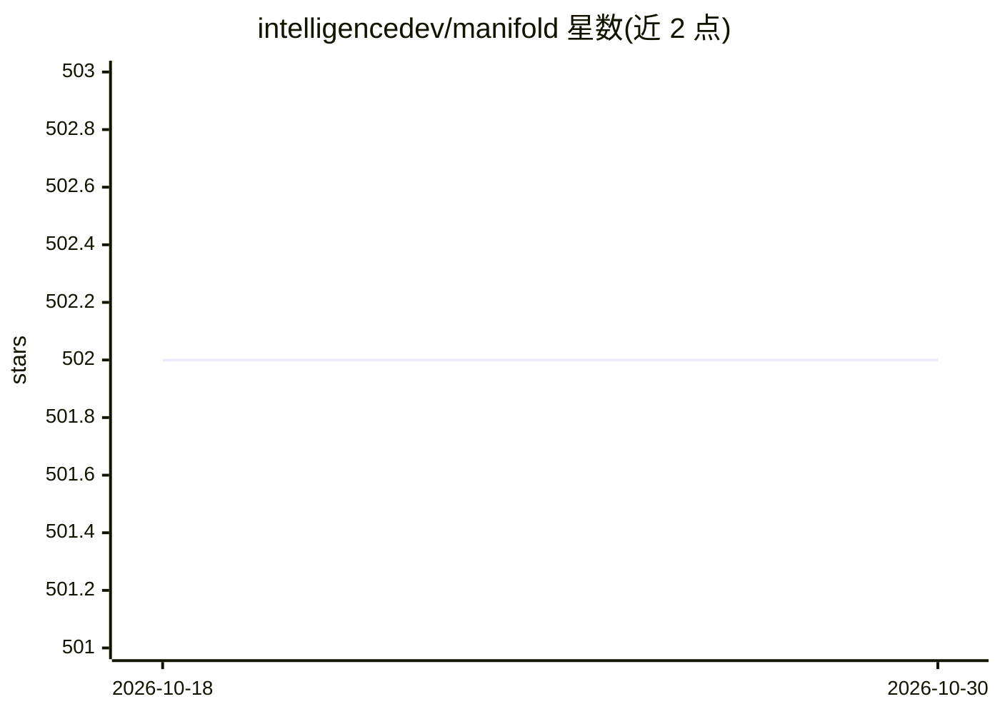

# intelligencedev/manifold

⭐ 502 · Go · MIT · 推送 2026-10-22 · [GitHub](https://github.com/intelligencedev/manifold) · [官网](https://intelligence.dev) · 个人维护

**实验性 AI 助手团队平台：面向长周期多步工作流自动化**

自托管的长周期工作流自动化平台：以“专家（specialists）+ 工具 + 项目 + 工作流”组成工作区，让多个 AI 助手协作处理持续数小时的多步目标。功能含 Agent 聊天、图像生成（OpenAI/Google/本地 ComfyUI MCP）、定时任务 Pulse、可视化工作流编辑器（保存的工作流可成为工具）、提示词/数据集实验场、MCP 支持。支持 OpenAI/Google/Anthropic 及 OpenAI 兼容端点（llama.cpp/vLLM 自托管模型）。README 明确声明为实验性，不建议用于要求强稳定性的生产环境。推荐 Docker Compose 部署，可脱离外部数据库以 SQLite 运行。

## 筛选速览

| 维度 | 判定 | 备注 |
|---|---|---|
| AI 角色 | `ai-native` | 本体是模型或模型工具 |
| 许可风险 | `permissive` | MIT |
| 部署形态 | `desktop` | 安装包/桌面程序 |
| 模型依赖 | local-ok | 支持本地模型 |
| 硬件要求 | — | 无带数字的原话,不猜 |
| 安装摩擦 | `low` | 无编译、无系统依赖或容器化 |
| 成熟度 | `idea` | |

## 能力要点

- 多专家 Agent 团队在隔离项目工作区内协作处理长周期多步目标
- 可视化工作流编辑器：MCP 工具暴露为节点，保存的工作流可复用为工具
- Pulse 定时任务，原生支持 Matrix 发送结果，可经 Skills/MCP 扩展渠道
- 自托管运行：Docker 部署或本地构建，默认 SQLite（FTS5+Vec1）持久化

## 适用场景

- 组建多 Agent 专家团队处理超出单次对话的复杂长期任务
- 通过可视化编辑器设计并复用 Agent 工作流
- 定时调度 Agent 任务并把结果推送到外部服务
- 用自有开源权重模型（llama.cpp/vLLM 端点）驱动全部工作流

## 场景标签

`多智能体` `工作流自动化` `AI 助手` · 领域:Agent 开发

## 证据(README 行号)

> L3: Manifold is an **experimental** platform for long-horizon workflow automation with teams of AI assistants.
> L12: Manifold is built for workflows that go beyond one-shot prompts. It gives you a workspace where specialists, tools,

## 星数曲线

2026-10-18 502 → 2026-10-30 502（+0）

---
*卡片 v1 · prompt 1.4 · 生成 2026-10-21 · 置信度 high · 依据 README sha `3f50aaf9ae86` · [字段定义](../../DATASET.md)*
