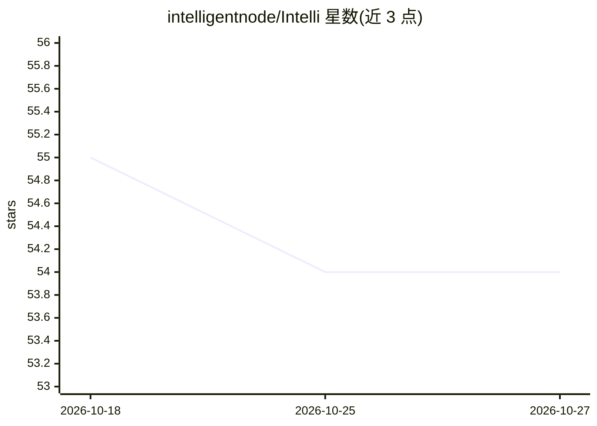

# intelligentnode/Intelli

⭐ 54 · Python · Apache-2.0 · 推送 2026-10-06 · [GitHub](https://github.com/intelligentnode/Intelli) · [官网](https://intellinode.ai) · 组织维护

**构建聊天机器人与 AI agent 工作流的 Python 框架**

Intelli 是一个创建聊天机器人和 AI agent 工作流的 Python 框架，通过统一访问层接入 OpenAI、LLaMA、deepseek、Stable Diffusion、Mistral 等多种模型，并支持 Model Context Protocol (MCP)。提供三层结构：wrapper 层访问底层模型、controller 层统一输入、function 层提供抽象功能；支持多 agent 流程、用自然语言从意图生成 agent 图（Vibe Agents）、路径受限工具集的编码 agent，以及基于 Anthropic/OpenAI computer-use 工具的浏览器/屏幕操作 agent。以 pip 包分发，另有 Claude Code 插件与 Codex 安装脚本供编码 agent 使用。

## 筛选速览

| 维度 | 判定 | 备注 |
|---|---|---|
| AI 角色 | `ai-ecosystem` | LLM/agent 周边工具 |
| 许可风险 | `permissive` | Apache-2.0 |
| 部署形态 | `library` | 以包/库形式分发 |
| 模型依赖 | local-ok | 支持本地模型 |
| 硬件要求 | — | 无带数字的原话,不猜 |
| 安装摩擦 | `low` | 无编译、无系统依赖或容器化 |
| 成熟度 | — | 结构信号不足 |

## 能力要点

- 统一访问层接入 OpenAI/LLaMA/deepseek/Stable Diffusion/Mistral 多模型
- Agent 流程编排与从意图生成 agent 图的 Vibe Agents
- 编码 agent（编辑→跑测试→迭代循环）与 computer-use 浏览器 agent
- 支持 MCP（含 MCP server/client 示例）

## 适用场景

- 编写可在多个模型提供商间切换的聊天机器人
- 编排由不同 AI 模型执行任务的多 agent 流程
- 让 Claude Code/Codex 等编码 agent 直接编写并运行 Intelli 流程

## 场景标签

`多智能体` `GUI 自动化` `编码 Agent` `Agent 框架` · 领域:Agent 开发

## 证据(README 行号)

> L10: A framework for creating chatbots and AI agent workflows. It enables seamless integration with multiple AI models, 
> L127: - **Flows**: create a flow of ai agents working toward user tasks.

## 星数曲线

2026-10-18 55 → 2026-10-27 54（-1）

---
*卡片 v1 · prompt 1.4 · 生成 2026-10-24 · 置信度 high · 依据 README sha `543b9d9fab1d` · [字段定义](../../DATASET.md)*
