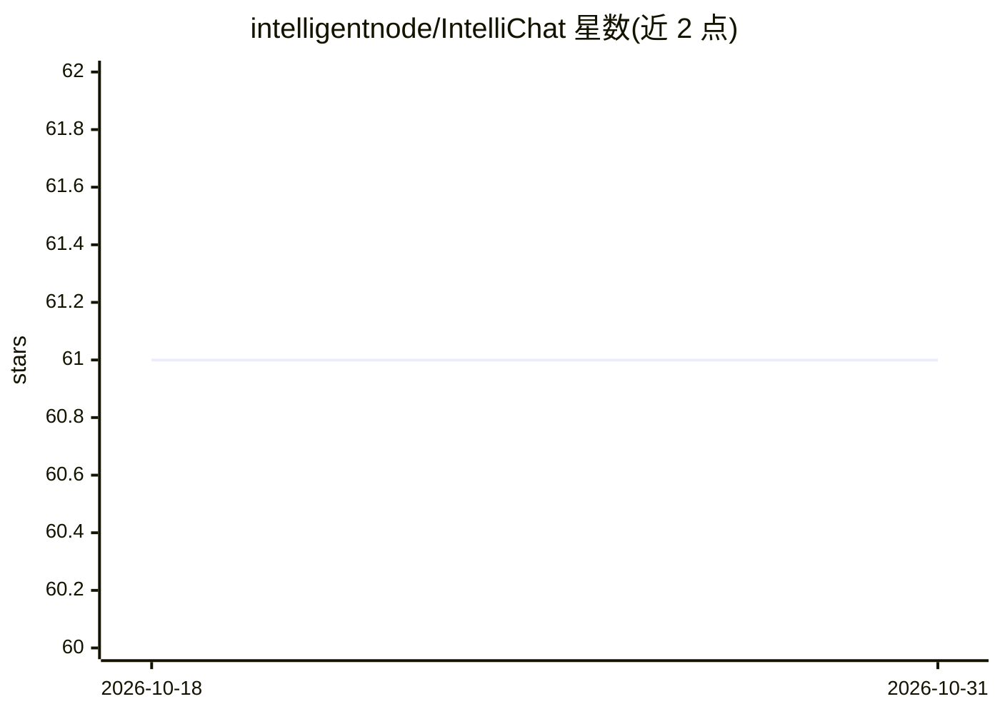

# intelligentnode/IntelliChat

⭐ 61 · TypeScript · MIT · 推送 2026-09-22 · [GitHub](https://github.com/intelligentnode/IntelliChat) · [官网](https://chat.intellinode.ai/) · 组织维护

**多模型开源 AI 聊天应用，UI 切换各家 LLM**

基于 IntelliNode 与 Next.js 构建的开源 AI 聊天应用，面向需要在聊天应用中集成多家语言模型的开发者与终端用户。可在 UI 中选择提供商与模型：OpenAI、Anthropic、Google Gemini、Cohere、Mistral、Azure OpenAI、Replicate、OpenRouter、Groq、DeepSeek，并支持 Ollama、LM Studio、vLLM 本地部署模型。功能含流式回复、图像生成、图片问答、语音输入播报、GitHub 仓库/本地代码目录接入。通过 pnpm/npm/yarn 安装依赖并启动 Next.js 服务器，支持 Vercel 一键部署与 Codespaces。

## 筛选速览

| 维度 | 判定 | 备注 |
|---|---|---|
| AI 角色 | `ai-native` | 本体是模型或模型工具 |
| 许可风险 | `permissive` | MIT |
| 部署形态 | `library` | 以包/库形式分发 |
| 模型依赖 | local-ok | 支持本地模型 |
| 硬件要求 | — | 无带数字的原话,不猜 |
| 安装摩擦 | `low` | 无编译、无系统依赖或容器化 |
| 成熟度 | — | 结构信号不足 |

## 能力要点

- UI 内切换 10+ 家 LLM 提供商与模型
- 支持 Ollama、LM Studio、vLLM 本地自托管模型
- 图像生成、图片问答、语音输入与回复朗读
- 连接 GitHub 仓库或本地代码目录供助手读取分析

## 适用场景

- 在同一聊天界面中使用多家厂商的模型
- 搭配 Ollama/vLLM 做本地模型对话
- 让助手读取 GitHub 仓库或本地文件夹分析代码

## 场景标签

`聊天机器人` `图像生成` · 领域:对话与助手

## 证据(README 行号)

> L13: IntelliChat is an open-source AI chatbot built with IntelliNode and Next.js. It is designed to accelerate the integ
> L19: - Select your preferred AI Provider and model from the UI.

## 星数曲线

2026-10-18 61 → 2026-10-31 61（+0）

---
*卡片 v1 · prompt 1.4 · 生成 2026-10-24 · 置信度 high · 依据 README sha `746d1e260017` · [字段定义](../../DATASET.md)*
