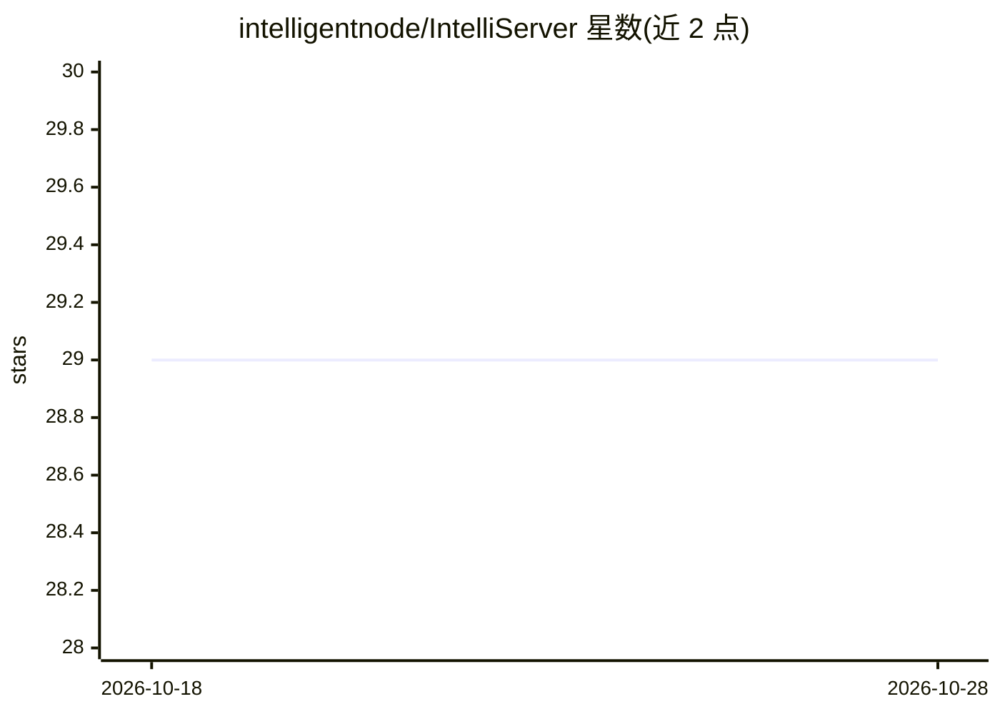

# intelligentnode/IntelliServer

⭐ 29 · JavaScript · MIT · 推送 2026-07-13 · [GitHub](https://github.com/intelligentnode/IntelliServer) · [官网](https://intelli-server.vercel.app) · 组织维护

**将多种 AI 模型封装为统一 API 的私有微服务**

基于 Node.js 的微服务，通过统一 API 接入 ChatGPT、Cohere、Llama、Stability、HuggingFace 推理及 AWS Sagemaker 等多种模型，支持同一端点格式下切换模型。功能包括聊天机器人、LLM 评测对比、语义搜索、扩散模型图像生成、聊天上下文提取、文档转文本解析与 OCR（AWS/Google Vision）。提供 API_KEY 与 ADMIN_KEY 保护端点，支持 npm 源码运行、Docker 构建与 Docker Hub 镜像（含 Mac M 系列 arm64 版本），附 Swagger 交互文档。

## 筛选速览

| 维度 | 判定 | 备注 |
|---|---|---|
| AI 角色 | `ai-ecosystem` | LLM/agent 周边工具 |
| 许可风险 | `permissive` | MIT |
| 部署形态 | `self-host` | docker 或自建部署 |
| 模型依赖 | locked-api |  |
| 硬件要求 | — | 无带数字的原话,不猜 |
| 安装摩擦 | `low` | 无编译、无系统依赖或容器化 |
| 成熟度 | — | 结构信号不足 |

## 能力要点

- 统一 API 端点格式接入多家模型并可切换
- LLM 评测对比功能辅助模型选型
- 聊天、语义搜索、图像生成、解析与 OCR 等端到端功能
- Docker Hub 发布镜像，含 arm64 版本

## 适用场景

- 在自有服务中统一调用多家 AI 模型
- 对比评测不同 LLM 以选择合适的模型
- 私有化部署聊天机器人、语义搜索与图像生成服务

## 场景标签

`模型网关` `模型评测` `图像生成` `语义搜索` · 领域:Agent 开发

## 证据(README 行号)

> L14: AI models as private microservice - ChatGPT, Cohere, Llama, Stability, Hugging inference and more.
> L16: Intelliserver is a microservice providing unified access to multiple AI models, allowing you to easily integrate cu
> L23: - **LLM Evaluation**: evaluate different AI models to choose the optimal solution for your requirements.

## 星数曲线

2026-10-18 29 → 2026-10-28 29（+0）

---
*卡片 v1 · prompt 1.4 · 生成 2026-10-26 · 置信度 high · 依据 README sha `10f12480036e` · [字段定义](../../DATASET.md)*
