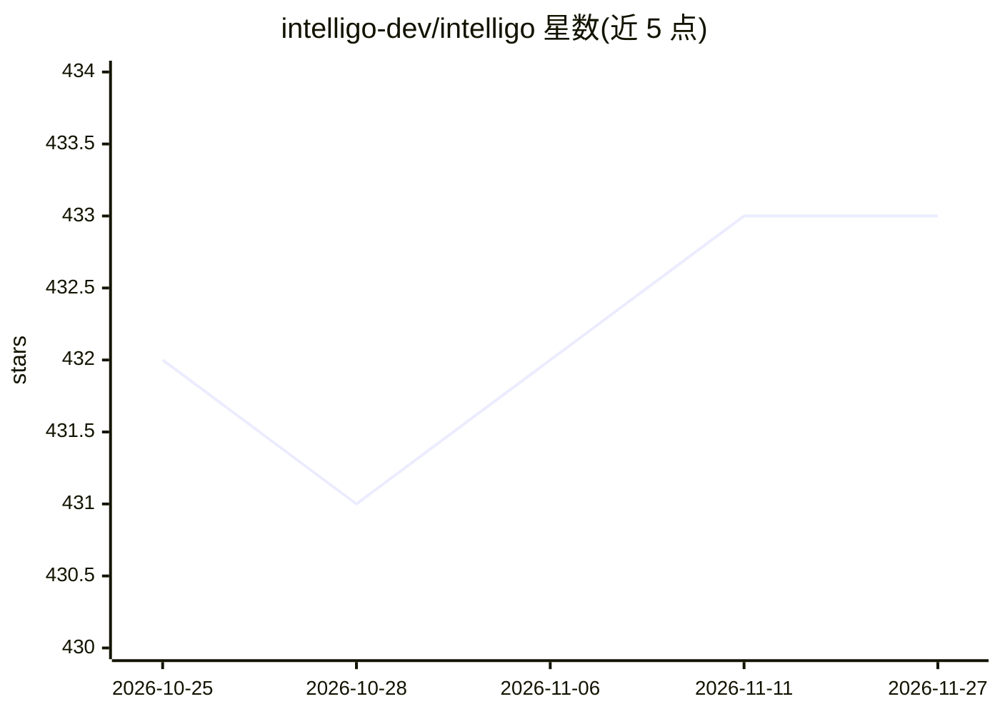

# intelligo-dev/intelligo

⭐ 433 · TypeScript · Apache-2.0 · 推送 2026-11-25 · [GitHub](https://github.com/intelligo-dev/intelligo) · [官网](https://intelligo.dev) · 组织维护

**为垂直 AI SaaS 提供鉴权、计费、执行边界等应用层框架**

Intelligo 自述为垂直 AI SaaS 的应用框架，补齐 agent 之外的部分：认证、多租户工作区、计划/功能门控、额度预留与结算、计量计费、审计。AI 路由保持用户框架原写法，框架只做 admit→run→settle 边界记录，不提供 agent 抽象。页面以 shadcn registry 区块源码安装，配置与文案隔离以保留升级能力。技术栈 Next.js 16/TypeScript/PostgreSQL+pgvector，单库无 Redis。限制：非 AI 框架、非组件库、非托管平台，需自行部署为 Next.js 应用；无运行时插件系统。

## 筛选速览

| 维度 | 判定 | 备注 |
|---|---|---|
| AI 角色 | `ai-ecosystem` | LLM/agent 周边工具 |
| 许可风险 | `permissive` | Apache-2.0 |
| 部署形态 | `self-host` | docker 或自建部署 |
| 模型依赖 | — | README 未给出锁定关系 |
| 硬件要求 | — | 无带数字的原话,不猜 |
| 安装摩擦 | `low` | 无编译、无系统依赖或容器化 |
| 成熟度 | — | 结构信号不足 |

## 能力要点

- 执行边界：admit 检查计划并冻结额度，settle 按实际 token 用 compare-and-swap 结算
- 页面以 registry 区块安装为源码，定制内容隔离在配置与消息文件中
- 模型 id 为注册表键，无定价的 id 在准入时拒绝并触发架构测试失败
- services 以可升级 npm 包交付，带单元、真实数据库与架构测试

## 适用场景

- 搭建垂直领域 AI SaaS，直接获得租户、计费、额度与审计能力
- 用 Vercel AI SDK 或 Mastra 写 agent，同时接入用量结算与扣费
- 从脚手架创建带 chat、dashboard、billing 设置页的应用
- 以多租户工作区+ Stripe 订阅/额度包方式向客户收费

## 场景标签

 · 领域:AI 应用开发框架/SaaS 基础设施

## 证据(README 行号)

> L36: Intelligo ships the second half finished and stays out of the first. There is no `IntelligoAgent`, no wrapper aroun
> L53: It is **not** an AI framework or a wrapper over one, not a component library, not a hosted platform — you deploy it
> L89: - **Admit** — the plan is checked through a port, the worst-case cost is held against the workspace's credits, and 

## 星数曲线

2026-10-25 432 → 2026-11-27 433（+1）

---
*卡片 v1 · prompt 1.4 · 生成 2026-11-25 · 置信度 mid · 依据 README sha `e1803d9eefca` · [字段定义](../../DATASET.md)*
