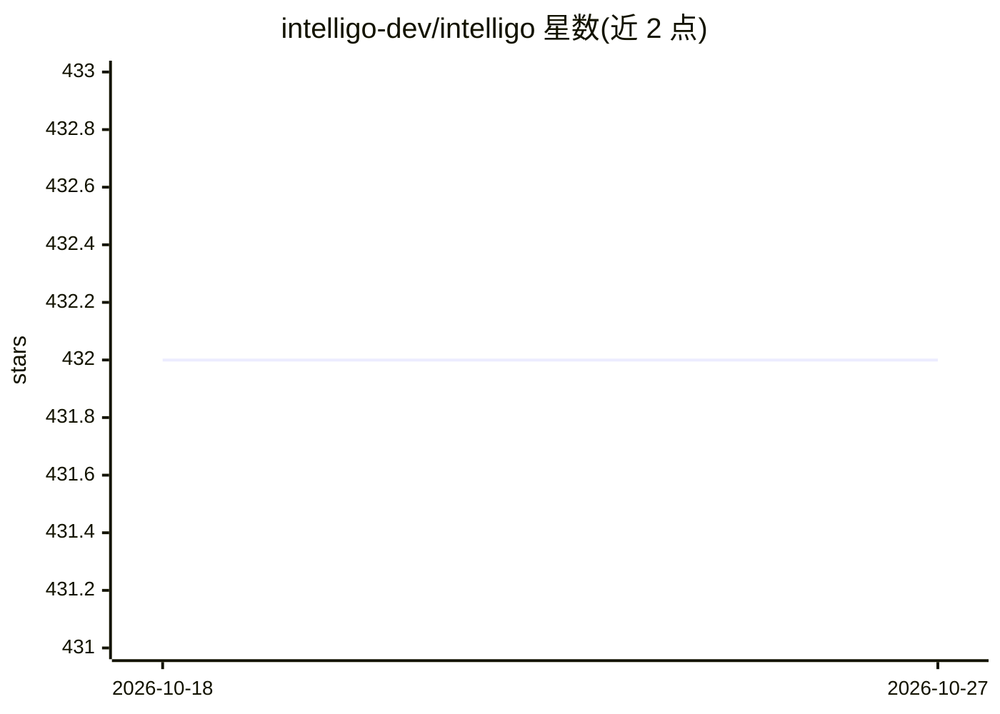

# intelligo-dev/intelligo

⭐ 432 · TypeScript · Apache-2.0 · 推送 2026-10-26 · [GitHub](https://github.com/intelligo-dev/intelligo) · [官网](https://intelligo.dev) · 组织维护

**垂直 AI SaaS 应用框架：为自有 agent 补齐认证、计费与额度等周边**

面向构建垂直 AI SaaS 的 TypeScript/Next.js 框架，覆盖产品中除 agent 本身外的公共部分：多租户工作区认证、Stripe 订阅与积分计费、执行边界（额度预留与结算）、审计、Postgres 任务队列与页面注册表。开发者保留自有 AI 框架（Vercel AI SDK、Mastra 等），Intelligo 只记录运行边界，不包装模型调用。限制：需 Node 22.14+、pnpm 9 与带 pgvector 的 PostgreSQL，组合发生在构建期、无运行时插件系统。

## 筛选速览

| 维度 | 判定 | 备注 |
|---|---|---|
| AI 角色 | `ai-ecosystem` | LLM/agent 周边工具 |
| 许可风险 | `permissive` | Apache-2.0 |
| 部署形态 | `self-host` | docker 或自建部署 |
| 模型依赖 | — | README 未给出锁定关系 |
| 硬件要求 | — | 无带数字的原话,不猜 |
| 安装摩擦 | `low` | 无编译、无系统依赖或容器化 |
| 成熟度 | — | 结构信号不足 |

## 能力要点

- 以 npm 包形式提供 auth/billing/executions/chat 等 11 个可升级服务包
- 执行边界实现额度预留、按 token 计价与防重复结算
- 页面以 shadcn 注册表 block 源码形式安装进应用
- CLI create/add/migrate/doctor/upgrade 含内容哈希防覆盖定制

## 适用场景

- 为自己的 agent 快速搭建带认证、工作区和计费的 SaaS 外壳
- 为 AI 运行做额度控制、用量计量与审计留痕
- 避免从零维护 SaaS 样板 fork，按包持续升级

## 场景标签

 · 领域:AI SaaS 应用框架

## 证据(README 行号)

> L35: Intelligo ships the second half finished and stays out of the first. There is no `IntelligoAgent`, no wrapper aroun
> L146: - **AI frameworks stay native.** The only thing Intelligo records about a run is its boundary.

## 星数曲线

2026-10-18 432 → 2026-10-27 432（+0）

---
*卡片 v1 · prompt 1.4 · 生成 2026-10-21 · 置信度 mid · 依据 README sha `750f93c66884` · [字段定义](../../DATASET.md)*
