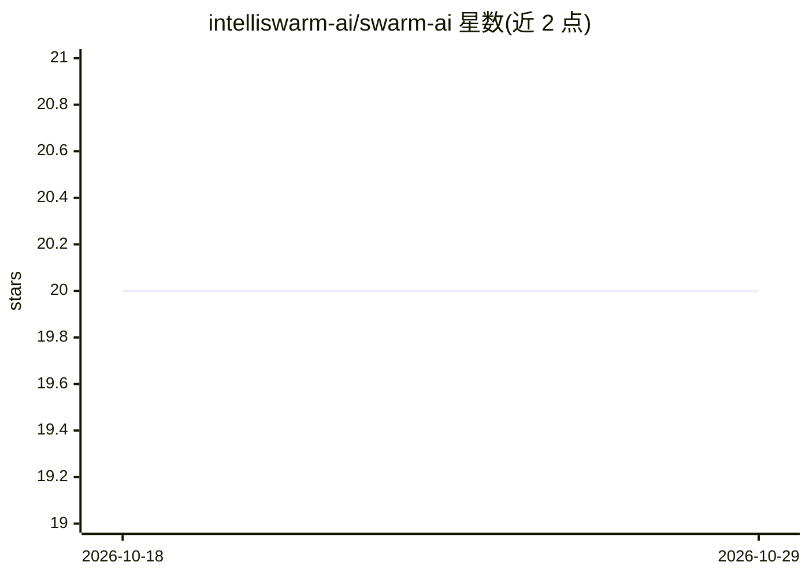

# intelliswarm-ai/swarm-ai

⭐ 20 · Java · Apache-2.0 · 推送 2026-07-18 · [GitHub](https://github.com/intelliswarm-ai/swarm-ai) · [官网](https://www.intelliswarm.ai) · 组织维护

**面向企业 Java 团队的多智能体编排框架**

基于 Spring AI 1.0.4 GA 与 Spring Boot 3.4 构建的 Java 多智能体编排框架，Maven 多模块（11 个）。支持 8 种流程类型（顺序/并行/层级/自改进等）、YAML 零代码 DSL、类型安全状态管理、动态技能生成与 RL 决策（LinUCB/Thompson Sampling）。企业特性含多租户、治理审批门、预算跟踪（token/成本）、工具 RBAC 权限、弹性熔断。内置 24 个工具与 MCP 适配器。核心模块 Apache 2.0，enterprise/studio 模块为 BSL 1.1 经 GitHub Packages 分发。

## 筛选速览

| 维度 | 判定 | 备注 |
|---|---|---|
| AI 角色 | `ai-ecosystem` | LLM/agent 周边工具 |
| 许可风险 | `permissive` | Apache-2.0 |
| 部署形态 | `self-host` | docker 或自建部署 |
| 模型依赖 | — | README 未给出锁定关系 |
| 硬件要求 | — | 无带数字的原话,不猜 |
| 安装摩擦 | `low` | 无编译、无系统依赖或容器化 |
| 成熟度 | `idea` | |

## 能力要点

- 8 种编排流程类型（含 SELF_IMPROVING 动态技能生成、DISTRIBUTED RAFT 共识）
- YAML 零代码 DSL 与 Maven BOM 版本管理
- 企业特性：多租户、审批门、token/成本预算强制、工具权限分级
- RL 策略引擎（LinUCB、NeuralLinUCB、Thompson Sampling）与 24 个内置工具

## 适用场景

- 在 JVM 团队中搭建带治理与预算控制的多智能体工作流
- 用 YAML 声明式定义代码评审、研究等 agent 流程
- 通过 SPI 扩展点接入企业审计、计费与许可体系

## 场景标签

`Agent 框架` `多智能体` · 领域:Agent 开发

## 证据(README 行号)

> L12: **A multi-agent orchestration framework for Java, designed for enterprise use.** Built on Spring AI 1.0.4 GA and Sp
> L44: ||SwarmAI|LangGraph|langchain4j|Spring AI|

## 星数曲线

2026-10-18 20 → 2026-10-29 20（+0）

---
*卡片 v1 · prompt 1.4 · 生成 2026-10-28 · 置信度 high · 依据 README sha `185c358da772` · [字段定义](../../DATASET.md)*
