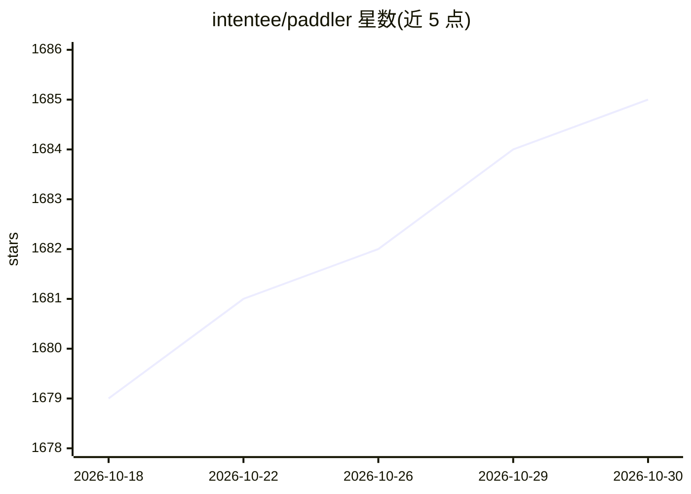

# intentee/paddler

⭐ 1,685 · Rust · Apache-2.0 · 推送 2026-10-26 · [GitHub](https://github.com/intentee/paddler) · [官网](https://paddler.intentee.com) · 组织维护

**自托管 LLM/VLM 负载均衡与服务平台，内置 llama.cpp 推理引擎**

面向需要在自有基础设施上运行和扩展 LLM 推理的团队的开源负载均衡与服务平台。采用单二进制分发，仅含两个可部署组件：balancer 分发请求并提供 Web 管理面板，agent 通过 slot 生成 token 与 embedding。推理使用内置 llama.cpp 引擎（自有 slot 实现，各自维护上下文与 KV cache）。支持动态加入 agent、请求缓冲（可从零主机扩容）、动态模型切换与可观测性指标；另有桌面应用（beta）面向多机本地集群场景。

## 筛选速览

| 维度 | 判定 | 备注 |
|---|---|---|
| AI 角色 | `ai-ecosystem` | LLM/agent 周边工具 |
| 许可风险 | `permissive` | Apache-2.0 |
| 部署形态 | `None` |  |
| 模型依赖 | — | README 未给出锁定关系 |
| 硬件要求 | — | 无带数字的原话,不猜 |
| 安装摩擦 | `low` | 无编译、无系统依赖或容器化 |
| 成熟度 | `idea` | |

## 能力要点

- balancer + agent 两组件架构，agent 可动态加入配合自动扩缩容
- 内置 llama.cpp 引擎，自有 slot 实现并维护各自上下文与 KV cache
- 请求缓冲支持从零主机扩容，支持动态模型切换
- 内置 Web 管理面板：监控、模型配置、GUI 推理测试

## 适用场景

- 在我的服务器上部署并横向扩展 LLM 推理服务
- 通过 Web 面板管理和监控模型集群
- 把办公室多台带 GPU 的电脑组成本地推理集群（桌面版）

## 场景标签

`推理引擎` · 领域:训练与推理

## 证据(README 行号)

> L5: Paddler is an open-source LLM load balancer and serving platform. It allows you to run inference, deploy, and scale 
> L11: * Inference through a built-in llama.cpp engine
> L42: There are only two deployable components, the `balancer` (which distributes the incoming requests), and the `agent`

## 星数曲线

2026-10-18 1,679 → 2026-10-30 1,685（+6）

---
*卡片 v1 · prompt 1.4 · 生成 2026-10-21 · 置信度 high · 依据 README sha `4ce1e327c77f` · [字段定义](../../DATASET.md)*
