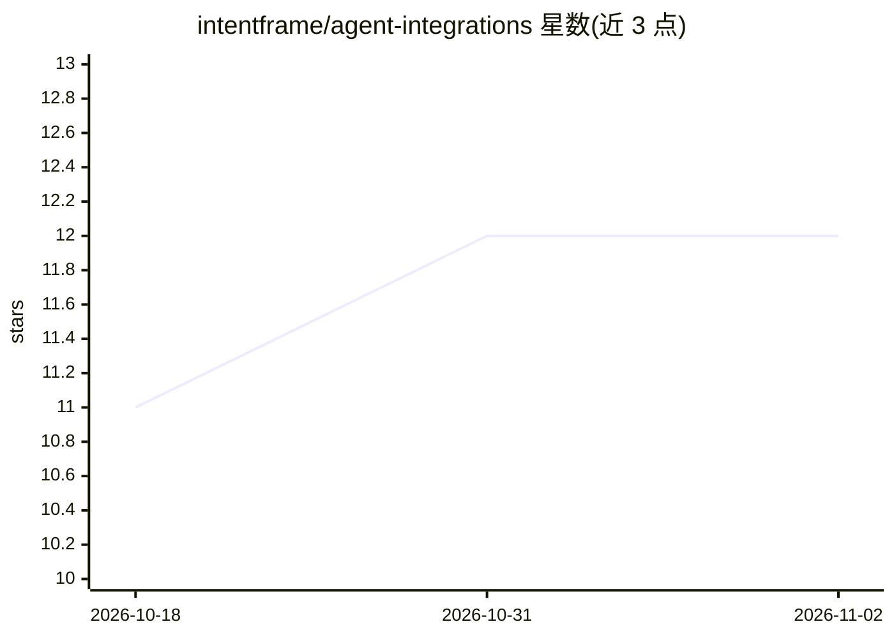

# intentframe/agent-integrations

⭐ 12 · Python · Apache-2.0 · 推送 2026-06-28 · [GitHub](https://github.com/intentframe/agent-integrations) · 组织维护

**为 Hermes Agent 提供外部策略检查点的安全治理插件**

IntentFrame 的 Hermes Agent（Nous Research）集成插件：在 agent 之外部署一个策略运行时，对 terminal、execute_code、write_file、patch、cronjob 五类工具调用做执行前判定，仅策略允许（ALLOW）的动作可运行，阻断动作被记录并留审计痕迹。安装形式为一键 curl 脚本（Linux/macOS），需 OPENAI_API_KEY；提供本地控制面板（:9720）、CLI 管理受治工具与 deny-by-default 的 YAML 策略，支持 Docker/无头安装，v0.2.1 版本在 root/FHS 卸载上存在已知限制。

## 筛选速览

| 维度 | 判定 | 备注 |
|---|---|---|
| AI 角色 | `ai-ecosystem` | LLM/agent 周边工具 |
| 许可风险 | `permissive` | Apache-2.0 |
| 部署形态 | `None` |  |
| 模型依赖 | — | README 未给出锁定关系 |
| 硬件要求 | — | 无带数字的原话,不猜 |
| 安装摩擦 | `low` | 无编译、无系统依赖或容器化 |
| 成熟度 | `idea` | |

## 能力要点

- 五类高风险 Hermes 工具（terminal/execute_code/write_file/patch/cronjob）默认纳入治理
- 策略判定在 agent 外部进程执行，deny-by-default，动作须在 allowed_actions 中
- 提供本地控制面板 Web UI（:9720）与 intentframe-integrations CLI 管理治理与策略
- 支持 Docker E2E、无头安装与固定版本安装，输出审计日志

## 适用场景

- 在 Hermes Agent 执行 shell 命令、写文件或定时任务前按我的策略做外部把关
- 拦截提权、越界路径写入、凭据读取等高危动作并留审计记录
- 通过 Web UI 或 CLI 调整哪些工具受治理、哪些动作放行

## 场景标签

`网络安全` · 领域:学习与行业

## 证据(README 行号)

> L4: **Put an external validation checkpoint in front of the tools Hermes Agent runs on your machine — terminal, code, fi
> L23: Hermes Agent is Nous Research's self-improving agent — terminal, tools, memory, cron, and a chat dashboard. This In
> L50: - An IntentFrame backend that decides **ALLOW** or **BLOCK**.

## 星数曲线

2026-10-18 11 → 2026-11-02 12（+1）

---
*卡片 v1 · prompt 1.4 · 生成 2026-11-01 · 置信度 high · 依据 README sha `3c6d1c74ad05` · [字段定义](../../DATASET.md)*
