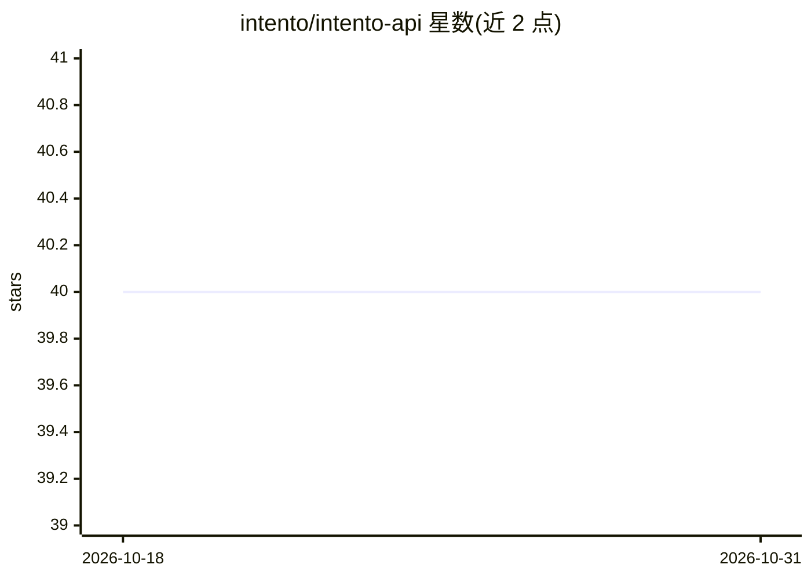

# intento/intento-api

⭐ 40 · 推送 2026-01-20 · [GitHub](https://github.com/intento/intento-api) · [官网](https://inten.to) · 组织维护

**多厂商认知 AI 服务的统一 API 网关：翻译/情感/OCR/语音转写**

Intento API 的规范与用户手册仓库：以统一的 intent 接口（如 ai.text.translate、ai.text.sentiment、ai.image.ocr、ai.speech.transcribe）聚合多家第三方认知服务厂商，按输入约束自动路由或指定 provider。支持基于 token 的 header 认证、异步模式处理超大请求（结果保留 30 天）、用自己的第三方账号凭证的 tech proxy 模式、key 池、Usage/Score/Evaluation 附加 API，以及 trace 调试开关。网关层限制为 100 请求/秒、100 万请求/月、单请求 100MB。

## 筛选速览

| 维度 | 判定 | 备注 |
|---|---|---|
| AI 角色 | `ai-ecosystem` | LLM/agent 周边工具 |
| 许可风险 | `none` | — |
| 部署形态 | `None` |  |
| 模型依赖 | — | README 未给出锁定关系 |
| 硬件要求 | — | 无带数字的原话,不猜 |
| 安装摩擦 | `low` | 无编译、无系统依赖或容器化 |
| 成熟度 | — | 结构信号不足 |

## 能力要点

- 统一 intent 接口聚合多家认知服务厂商，POST 即完成调用
- tech proxy 模式支持使用自有第三方凭证与 key 池
- 异步模式处理超大请求，操作结果 TTL 30 天
- 附带 Usage 统计、BLEU 等 Score 计算与模型评测 API

## 适用场景

- 在多个机器翻译/认知服务厂商间统一接入与路由
- 对比不同 provider 对特定语言对的支持
- 用自有第三方账号凭证经统一接口调用服务

## 场景标签

`模型网关` `模型评测` · 领域:Agent 开发

## 证据(README 行号)

> L13: Intento API provides a uniform intent-based access to cognitive services from multiple providers, available at the 
> L36: In order to fulfill an intent (e.g. translate some text), use `POST` requests. The request is routed to a provider 

## 星数曲线

2026-10-18 40 → 2026-10-31 40（+0）

---
*卡片 v1 · prompt 1.4 · 生成 2026-10-25 · 置信度 high · 依据 README sha `7e6654353550` · [字段定义](../../DATASET.md)*
