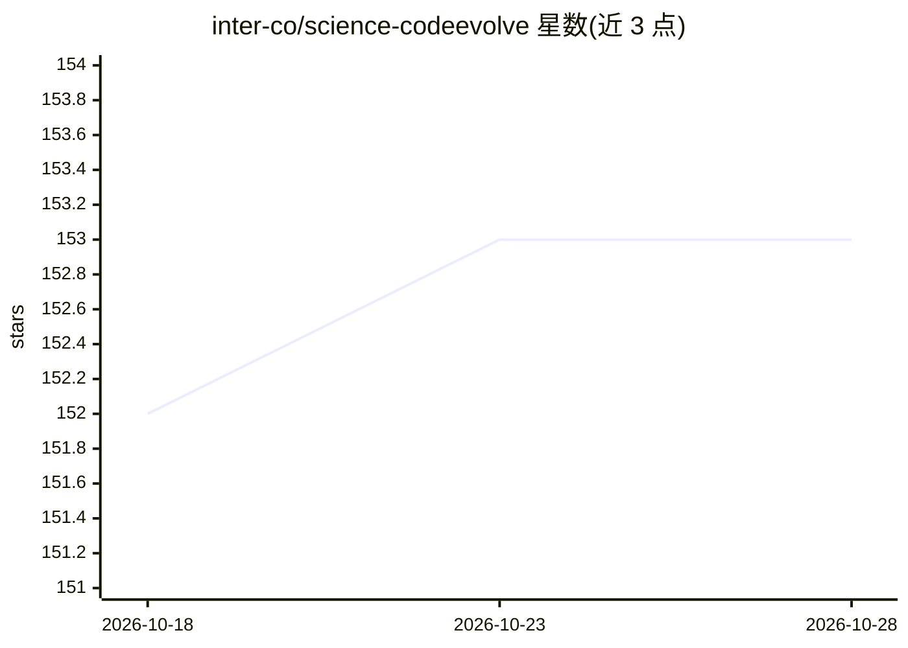

# inter-co/science-codeevolve

⭐ 153 · Python · Apache-2.0 · 推送 2026-04-08 · [GitHub](https://github.com/inter-co/science-codeevolve) · [官网](https://arxiv.org/abs/2510.14150) · 组织维护

**开源 LLM+遗传算法的代码进化优化框架，用于算法发现与优化**

结合大语言模型与进化算法的开源框架，面向算法发现与优化任务：多个岛屿种群独立进化并定期迁移，LLM 生成 SEARCH/REPLACE diff 产生新候选代码，在沙箱中按资源限制评估适应度；支持启发式交叉、元提示进化、MAP-Elites 质量多样性存档与多模型加权集成。通过 OpenAI 兼容 API 接入任意 LLM 端点。主要在 Linux 上开发测试，部分 CPU 绑定与资源监控功能为 Linux 特有；以 conda 环境与命令行方式安装运行。

## 筛选速览

| 维度 | 判定 | 备注 |
|---|---|---|
| AI 角色 | `ai-ecosystem` | LLM/agent 周边工具 |
| 许可风险 | `permissive` | Apache-2.0 |
| 部署形态 | `None` |  |
| 模型依赖 | — | README 未给出锁定关系 |
| 硬件要求 | — | 无带数字的原话,不猜 |
| 安装摩擦 | `low` | 无编译、无系统依赖或容器化 |
| 成熟度 | — | 结构信号不足 |

## 能力要点

- 岛屿遗传算法：多种群并行进化与拓扑可配置的迁移机制
- LLM 生成结构化 SEARCH/REPLACE diff，只修改指定进化区代码
- MAP-Elites 质量多样性存档（grid/CVT 两种特征图）
- 支持多 LLM 加权集成，兼容任意 OpenAI 兼容端点

## 适用场景

- 发现求解组合优化或数学问题的新算法
- 以可复现方式优化计算内核代码
- 研究 LLM 驱动进化搜索中各组件的贡献（消融）

## 场景标签

`编码 Agent` · 领域:编码与开发

## 证据(README 行号)

> L13: **An open-source framework that combines large language models with evolutionary algorithms to discover and optimiz
> L49: **OpenAI-Compatible APIs:** Works with any OpenAI-compatible endpoint including vLLM, Ollama, Together AI, and clou
> L53: CodeEvolve operates as a distributed evolutionary algorithm where code itself is the evolving entity:

## 星数曲线

2026-10-18 152 → 2026-10-28 153（+1）

---
*卡片 v1 · prompt 1.4 · 生成 2026-10-23 · 置信度 high · 依据 README sha `802f91b3b232` · [字段定义](../../DATASET.md)*
