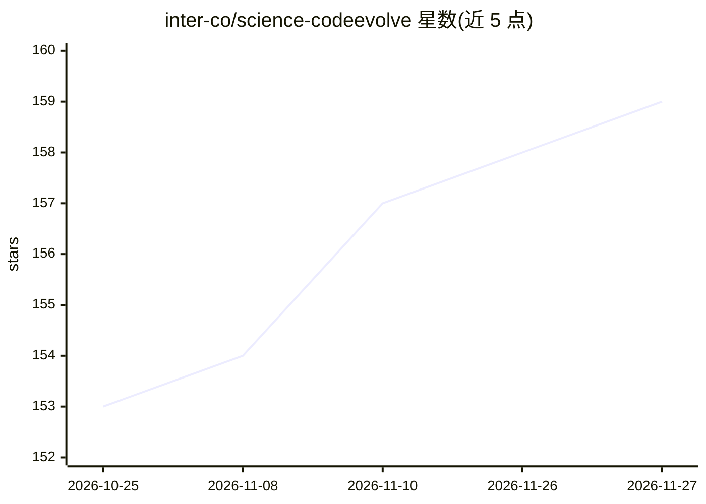

# inter-co/science-codeevolve

⭐ — · [GitHub]() · 组织维护

**开源进化式编码代理：用 LLM 驱动算法发现与优化**

CodeEvolve 将大语言模型与进化算法结合，用于自动发现和优化代码解决方案。核心机制包括岛屿模型遗传算法（多种群独立演化并周期性迁移优秀解）、模块化进化算子（基于灵感的交叉、元提示探索、基于深度的利用）、可选 MAP-Elites 质量多样性存档，以及加权多模型 LLM 集成。候选代码在沙箱环境中限时/限内存评估并提取适应度。安装采用 git clone 加 conda 环境，通过环境变量配置任意 OpenAI 兼容 API 端点，主要在 Linux 上开发测试，部分特性（CPU 绑定、进程树管理）依赖 Linux。

## 筛选速览

| 维度 | 判定 | 备注 |
|---|---|---|
| AI 角色 | `ai-native` | 本体是模型或模型工具 |
| 许可风险 | `permissive` | — |
| 部署形态 | `None` |  |
| 模型依赖 | local-ok | 支持本地模型 |
| 硬件要求 | — | 无带数字的原话,不猜 |
| 安装摩擦 | `low` | 无编译、无系统依赖或容器化 |
| 成熟度 | — | 结构信号不足 |

## 能力要点

- 岛屿模型遗传算法，多种群独立演化并周期性迁移
- 支持混合多个 LLM 加权集成的探索/利用组合
- 沙箱化评估：时间/内存限制、进程树管理、指标提取
- 兼容任意 OpenAI 端点（vLLM、Ollama、Together AI 等）

## 适用场景

- 发现或优化组合优化问题的算法
- 优化计算内核等程序综合任务
- 在有限预算下用开源权重模型做算法搜索研究

## 场景标签

`编码 Agent` · 领域:编码与开发

## 证据(README 行号)

> L14: **An open-source framework that combines large language models with evolutionary algorithms to discover and optimiz
> L64: 3. **Variation**: Generate new candidates through LLM-driven operations
> L73: 5. **Evaluation**: Execute in sandboxed environment

## 星数曲线

2026-10-25 153 → 2026-11-27 159（+6）

---
*卡片 v1 · prompt 1.4 · 生成 2026-11-27 · 置信度 high · 依据 README sha `7c1f69aee4b7` · [字段定义](../../DATASET.md)*
