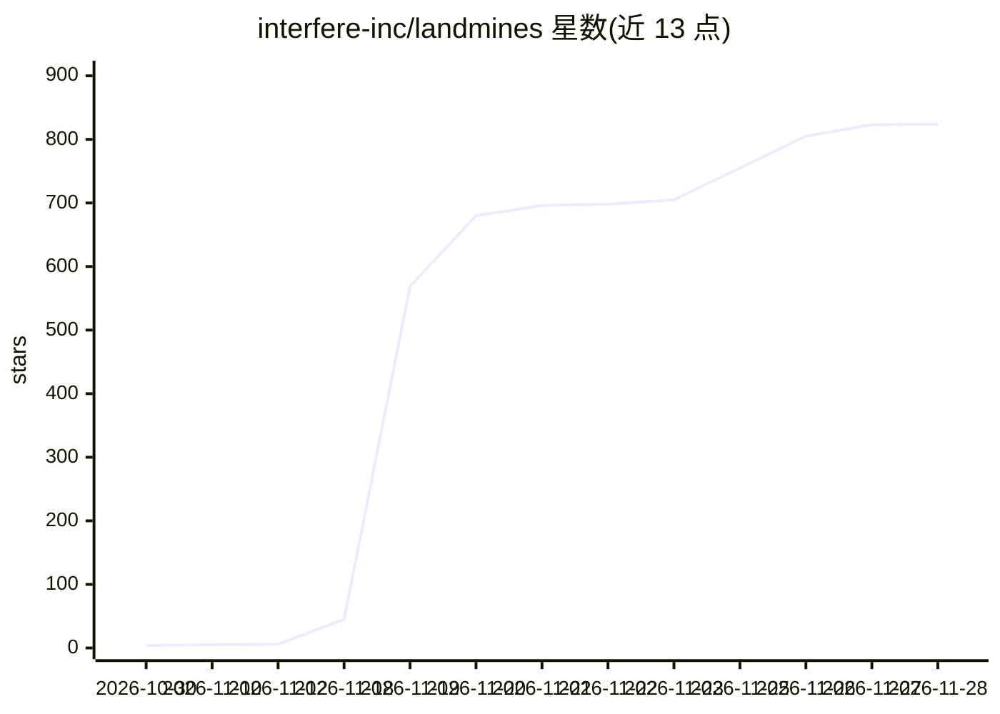

# interfere-inc/landmines

⭐ 824 · TypeScript · MIT · 推送 2026-11-27 · [GitHub](https://github.com/interfere-inc/landmines) · [官网](https://www.npmjs.com/package/@interfere/landmines) · 组织维护

**约束 AI 生成代码的 Oxlint 规则集：禁 mock、禁 sleep 掩盖真实失败**

一组 Oxlint 插件规则，针对 coding agent 产出的测试与源码中的掩盖性行为：规则拦截测试替身（模块 mock、stub）、固定 sleep、无信号轮询、flake 重试与超时上调、静默 catch、陈旧断言等模式，报错消息指示替代写法使修复回到同一循环完成。规则按 correctness/suspicious/pedantic/style/restriction 分组，以分层配置或手动挑选方式接入 .oxlintrc.json。要求 Oxlint ≥1.81 与 Node ≥22.18，规则多数支持配置项（allow、harnessModules、appFactories、publicApi 等）。

## 筛选速览

| 维度 | 判定 | 备注 |
|---|---|---|
| AI 角色 | `ai-enhanced` | 去掉 AI 部分产品仍成立 |
| 许可风险 | `permissive` | MIT |
| 部署形态 | `None` |  |
| 模型依赖 | — | README 未给出锁定关系 |
| 硬件要求 | — | 无带数字的原话,不猜 |
| 安装摩擦 | `low` | 无编译、无系统依赖或容器化 |
| 成熟度 | — | 结构信号不足 |

## 能力要点

- no-test-doubles 拦截模块 mock 与 stub，要求真实实现与 MSW 处理网络
- no-fixed-sleep/no-unsignaled-poll 拦截定时等待与无信号轮询
- no-flake-masking 禁止测试重试与超时上调（Vitest/Playwright/jest.retryTimes）
- 按 Oxlint 分类分层的 6 套配置（recommended/correctness/…/all）

## 适用场景

- 团队用 coding agent 写代码时在 CI 中拦截 mock 与 flake 掩盖
- 为 Vitest/Playwright 测试库统一禁用 sleep 与重试掩盖
- monorepo 中约束测试文件放置、导出与脚本命名规范

## 场景标签

 · 领域:开发工具/代码质量

## 证据(README 行号)

> L3: Oxlint rules that keep AI-written code honest.
> L5: Coding agents are fast, and they optimise for green checks. Left alone, they
> L10: `landmines` makes the honest path the only one that lints. Each rule fails

## 星数曲线

2026-10-30 4 → 2026-11-28 824（+820）

---
*卡片 v1 · prompt 1.4 · 生成 2026-11-26 · 置信度 high · 依据 README sha `5f472b6a1075` · [字段定义](../../DATASET.md)*
