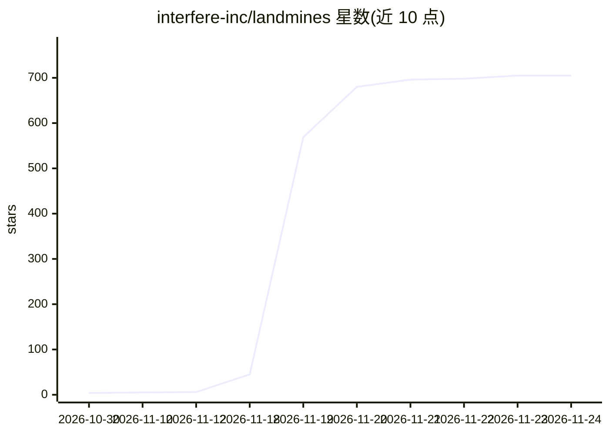

# interfere-inc/landmines

⭐ 705 · TypeScript · MIT · 推送 2026-11-18 · [GitHub](https://github.com/interfere-inc/landmines) · [官网](https://www.npmjs.com/package/@interfere/landmines) · 组织维护

**面向 AI 生成代码的 Oxlint 规则集：约束测试真实性与代码规范**

一组 Oxlint 插件规则，针对 coding agent 产出代码中的常见做法：测试中替换被测依赖（mock/stub）、固定 sleep 等待竞态、失败重试与提高超时掩盖 flake、无信息注释、测试文件位置与命名随意、包导出无入口约束等。每条规则失败时给出替代做法的提示，使修复在同一反馈闭环内完成。支持按文件精确计数的 allowlist 逐量收紧，需 Oxlint 1.81+ 与 Node 22.18+，MIT 许可。

## 筛选速览

| 维度 | 判定 | 备注 |
|---|---|---|
| AI 角色 | `ai-enhanced` | 去掉 AI 部分产品仍成立 |
| 许可风险 | `permissive` | MIT |
| 部署形态 | `None` |  |
| 模型依赖 | — | README 未给出锁定关系 |
| 硬件要求 | — | 无带数字的原话,不猜 |
| 安装摩擦 | `low` | 无编译、无系统依赖或容器化 |
| 成熟度 | — | 结构信号不足 |

## 能力要点

- 4 个插件：testing/style/structure/types 共 10 条规则
- no-flake-masking 禁止测试重试与提高超时，allowlist 支持只减不增的收紧模式
- strict-msw 要求 MSW 未处理请求报错，防止未 mock 请求到达真实网络
- 规则失败消息直接告知 agent 或人应如何修复

## 适用场景

- 让 coding agent 写出的测试使用真实实现而非 mock 一切
- 治理已有代码库中的 flaky 测试并逐量收紧
- 约束测试文件命名、位置与包的公开入口

## 场景标签

 · 领域:开发者工具/代码质量

## 证据(README 行号)

> L3: Oxlint rules that keep AI-written code honest.
> L5: Coding agents are fast, and they optimise for green checks. Left alone, they
> L10: `landmines` makes the honest path the only one that lints. Each rule fails

## 星数曲线

2026-10-30 4 → 2026-11-24 705（+701）

---
*卡片 v1 · prompt 1.4 · 生成 2026-11-24 · 置信度 high · 依据 README sha `4fb39d218216` · [字段定义](../../DATASET.md)*
