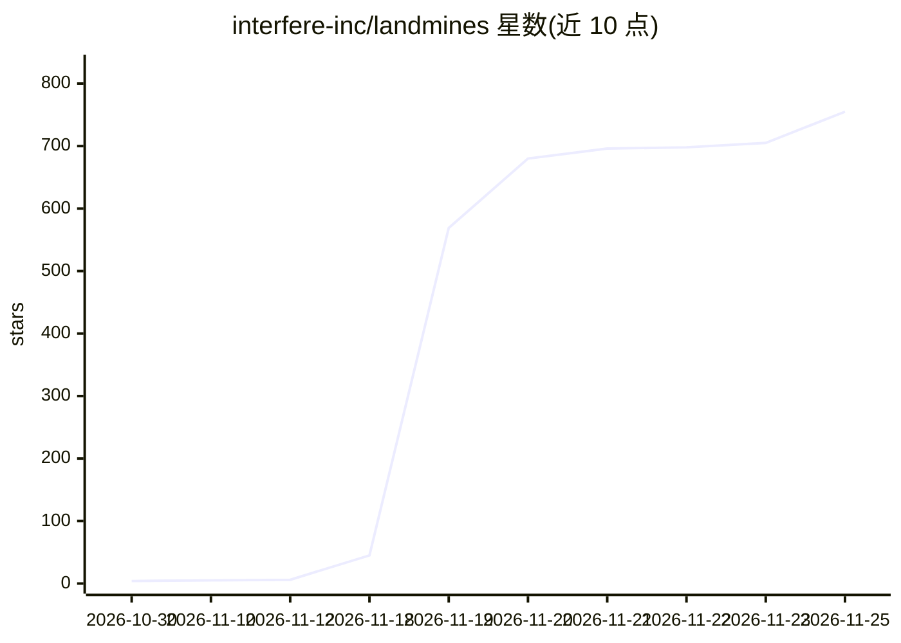

# interfere-inc/landmines

⭐ 755 · TypeScript · MIT · 推送 2026-11-23 · [GitHub](https://github.com/interfere-inc/landmines) · [官网](https://www.npmjs.com/package/@interfere/landmines) · 组织维护

**约束 AI 生成代码质量的 Oxlint 规则插件**

面向 Oxlint 的规则插件集，检测 AI 编码 agent 常见的掩盖性问题：测试替身/mock、固定 sleep、轮询竞态、重试与超时掩盖 flake、静默 catch、文件与导出数量失控、随意注释等。规则按 correctness/suspicious/pedantic/style/restriction 分类提供可叠加的配置，每条违规附带指引修复的消息，可与 agent 的修复循环衔接。要求 Oxlint ≥1.81、Node ≥22.18，在 Interfere 生产环境使用。

## 筛选速览

| 维度 | 判定 | 备注 |
|---|---|---|
| AI 角色 | `ai-enhanced` | 去掉 AI 部分产品仍成立 |
| 许可风险 | `permissive` | MIT |
| 部署形态 | `None` |  |
| 模型依赖 | — | README 未给出锁定关系 |
| 硬件要求 | — | 无带数字的原话,不猜 |
| 安装摩擦 | `low` | 无编译、无系统依赖或容器化 |
| 成熟度 | — | 结构信号不足 |

## 能力要点

- 按 Oxlint 分类提供 recommended/correctness/suspicious/pedantic/style/restriction 等可叠加配置
- 违规消息直接告知 agent 或人如何修复，融入同一修复循环
- 针对测试质量：禁止 test doubles、固定 sleep、flake 掩盖（重试/提高超时）等模式
- pedantic 类规则支持 allow 映射，只降不升的基线管理

## 适用场景

- 在 CI 中拦截 AI agent 写出的 mock 掩盖、sleep 赌竞态等假绿测试
- 用 lint 反馈驱动编码 agent 自动修复不诚实的测试代码
- 对大型 monorepo 施加文件行数、导出数、注释与测试目录的仓库政策

## 场景标签

 · 领域:开发工具/代码质量

## 证据(README 行号)

> L3: Oxlint rules that keep AI-written code honest.
> L14: Built and used in production at Interfere.

## 星数曲线

2026-10-30 4 → 2026-11-25 755（+751）

---
*卡片 v1 · prompt 1.4 · 生成 2026-11-25 · 置信度 high · 依据 README sha `5cb9a850b558` · [字段定义](../../DATASET.md)*
