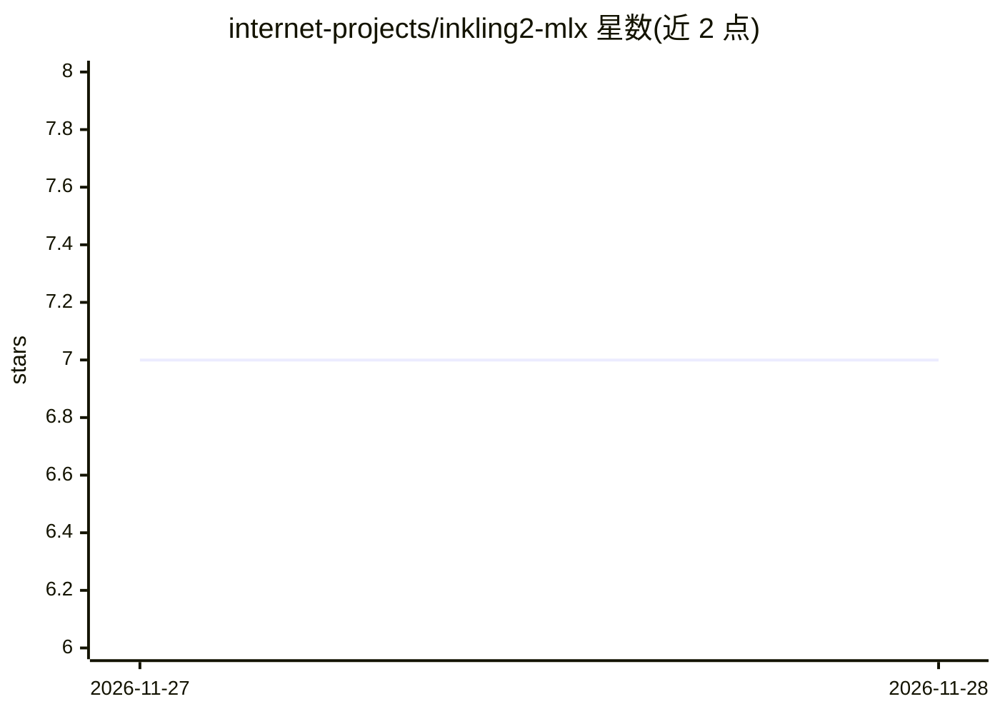

# internet-projects/inkling2-mlx

⭐ 7 · Python · MIT · 推送 2026-11-26 · [GitHub](https://github.com/internet-projects/inkling2-mlx) · [官网](https://netprojects.com) · 组织维护

**在 Apple Silicon 上以 MLX-VLM 运行 Inkling 2 Mini 的推理运行时**

基于 MLX-VLM（v0.2.0 起固定于上游 commit fd6404f）的分支，加载 Thinking Machines 的 Inkling 2 Mini 环形 MoE 模型（26.4B 参数），支持文本与图像输入、DSpark 投机解码草稿、工具调用解析器（mlx_vlm.server 返回 OpenAI tool_calls）及 NVFP4/MXFP8 原始权重。提供 5 档量化 HF 模型仓库，含兼容 OpenAI 的本地服务器，并记录各版本解码速度与 KL/GSM8K 校验数据。发布者声明与 Thinking Machines 无关联。

## 筛选速览

| 维度 | 判定 | 备注 |
|---|---|---|
| AI 角色 | `ai-ecosystem` | LLM/agent 周边工具 |
| 许可风险 | `permissive` | MIT |
| 部署形态 | `library` | 以包/库形式分发 |
| 模型依赖 | — | README 未给出锁定关系 |
| 硬件要求 | — | 无带数字的原话,不猜 |
| 安装摩擦 | `low` | 无编译、无系统依赖或容器化 |
| 成熟度 | — | 结构信号不足 |

## 能力要点

- 支持文本与图像输入及 OpenAI 格式 tool_calls 的本地服务器
- DSpark/DFlash2 投机解码，含 auto-off 自动开关机制
- 提供 5 档量化模型（2bit-mixed 至 4-8bit），适配 16–128 GB Mac
- v0.2.8 起可加载为其他运行时转换的 Inkling MLX 构建

## 适用场景

- 在 Apple Silicon Mac 上本地运行 Inkling 2 Mini 生成文本与图像理解结果
- 为本地应用提供 OpenAI 兼容的带工具调用 API 服务
- 在内存受限的 Mac 上选择低比特量化构建运行模型

## 场景标签

`多模态` `模型量化` `推理引擎` · 领域:感知与多模态

## 证据(README 行号)

> L3: MLX-VLM with support for Thinking Machines' Inkling 2 Mini, the
> L8: Since 21 November 2026, Inkling 2 Mini is supported in MLX-VLM itself (pull request #2778, merged into
> L145: mlx_vlm.server --model netprojects/Inkling-2-Mini-MLX-4-8bit --port 8000

## 星数曲线

2026-11-27 7 → 2026-11-28 7（+0）

---
*卡片 v1 · prompt 1.4 · 生成 2026-11-27 · 置信度 high · 依据 README sha `1fe891a73a63` · [字段定义](../../DATASET.md)*
