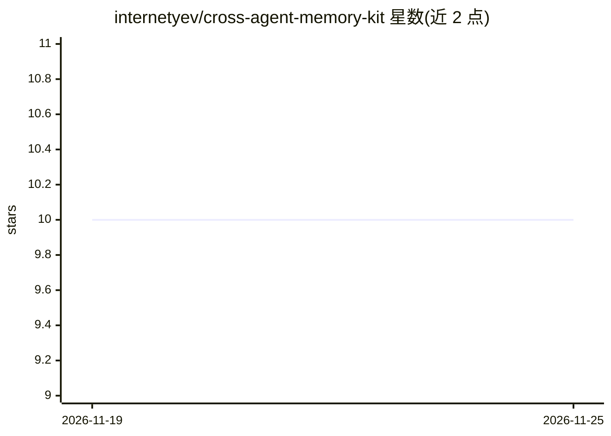

# internetyev/cross-agent-memory-kit

⭐ 10 · Python · MIT · 推送 2026-11-06 · [GitHub](https://github.com/internetyev/cross-agent-memory-kit) · 个人维护

**为 AI 编程 agent 提供跨工具持久化自更新记忆的配置套件**

解决 AI 编程 agent 每次会话从零开始、反复重述上下文的问题：仓库提供 mcp-memory-service（本地 stdio MCP 服务器，SQLite-vec 存储）的可复现配置，配合 /mcp-memory-query 检索技能与会话结束后的蒸馏钩子——钩子把会话转录发给所选 LLM，提取事实与决策存回记忆服务。支持多设备同步（Cloudflare D1+Vectorize 后端）、共享账号下的多人私享+共享记忆隔离，以及 LangSmith 全程追踪。提供交互式 onboard.py 向导与手动安装脚本；仅支持 macOS/Linux，Windows 未测试。

## 筛选速览

| 维度 | 判定 | 备注 |
|---|---|---|
| AI 角色 | `ai-ecosystem` | LLM/agent 周边工具 |
| 许可风险 | `permissive` | MIT |
| 部署形态 | `None` |  |
| 模型依赖 | — | README 未给出锁定关系 |
| 硬件要求 | — | 无带数字的原话,不猜 |
| 安装摩擦 | `low` | 无编译、无系统依赖或容器化 |
| 成熟度 | — | 结构信号不足 |

## 能力要点

- 会话后蒸馏钩子：将转录提炼为事实存入本地 mcp-memory-service
- 多用户模式：共享账号下每人私有记忆+共享存储，独立 Cloudflare D1 数据库硬隔离
- 多设备同步：Cloudflare D1+Vectorize 为源，本地 SQLite 缓存
- 为 Claude Code/Codex/Cursor/Gemini/Windsurf/Kiro 分别给出 MCP 配置与技能安装步骤

## 适用场景

- 让多个 AI 编程工具共享同一份项目决策与约定记忆
- 团队/家庭共用一个 agent 账号时保留各自私有笔记
- 换机器或新装 agent 时一键复现完整记忆服务配置

## 场景标签

`Agent 记忆` · 领域:Agent 开发

## 证据(README 行号)

> L5: **What is it for:** AI coding agents start every session cold. They forget the decisions, conventions, and dead ends
> L17: 1. **`mcp-memory-service`** running locally as a stdio MCP server. SQLite-vec storage. Persists facts, decisions, c
> L19: 3. A **post-session distillation hook** that, after each Claude Code session, sends the transcript to a chosen LLM 

## 星数曲线

2026-11-19 10 → 2026-11-25 10（+0）

---
*卡片 v1 · prompt 1.4 · 生成 2026-11-19 · 置信度 high · 依据 README sha `550bd3a8ca38` · [字段定义](../../DATASET.md)*
