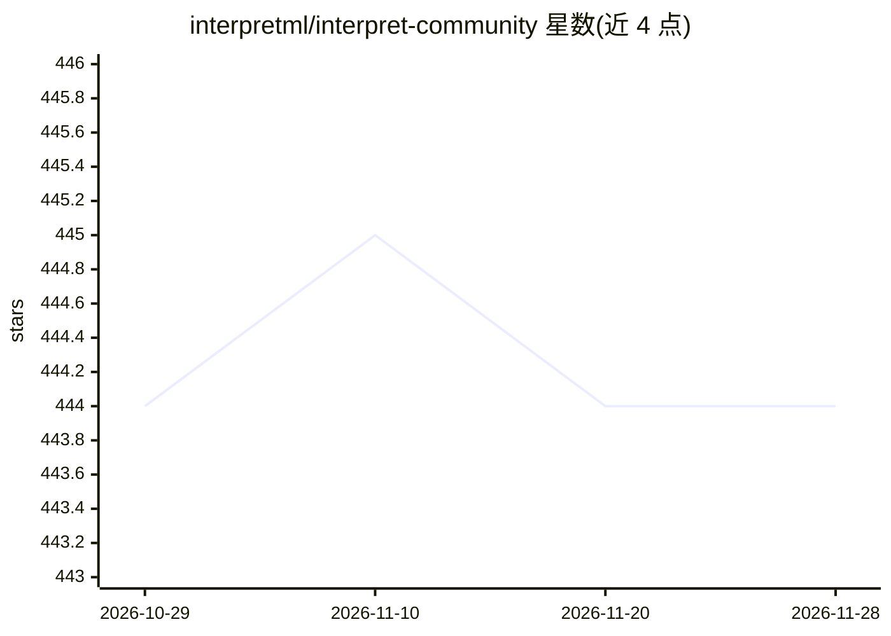

# interpretml/interpret-community

⭐ 444 · Python · MIT · 推送 2026-11-16 · [GitHub](https://github.com/interpretml/interpret-community) · [官网](https://interpret-community.readthedocs.io/en/latest/index.html) · 组织维护

**为数据科学家扩展表格模型可解释性技术的 Python SDK**

在 Interpret 仓库基础上扩展的实验性可解释性工具包：集成 SHAP Kernel/Tree/Deep/Linear、LIME、PFI、Mimic（全局代理模型）及自研 TabularExplainer 等技术，统一 API 对表格数据训练的模型生成全局与局部特征解释；支持 numpy/pandas/scipy 输入格式与遵循 Scikit predict 约定的模型和管道，并支持 PyTorch/TensorFlow/Keras 训练的模型，提供 GPU 加速的 Kernel Explainer 与可视化仪表盘（已迁移至 raiwidgets/responsible-ai-toolbox）。README 自述为实验性项目。

## 筛选速览

| 维度 | 判定 | 备注 |
|---|---|---|
| AI 角色 | `ai-ecosystem` | LLM/agent 周边工具 |
| 许可风险 | `permissive` | MIT |
| 部署形态 | `library` | 以包/库形式分发 |
| 模型依赖 | — | README 未给出锁定关系 |
| 硬件要求 | — | 无带数字的原话,不猜 |
| 安装摩擦 | `low` | 无编译、无系统依赖或容器化 |
| 成熟度 | `idea` | |

## 能力要点

- 统一 API 覆盖 SHAP、LIME、PFI、Mimic 等多种解释技术
- 支持 PyTorch/TensorFlow/Keras 训练的模型与 predict/predict_proba 管道
- GPU SHAP Kernel Explainer（基于 cuML）加速解释计算
- 支持逆向特征工程管道，以原始特征给出模型洞察

## 适用场景

- 解释表格数据上训练的机器学习模型的全局与局部特征重要性
- 对深度学习模型（PyTorch/TensorFlow/Keras）计算 SHAP 解释
- 在 notebook 中通过仪表盘分析模型性能与特征贡献
- 研究者扩展与对比实验性可解释性技术

## 场景标签

 · 领域:机器学习/模型可解释性

## 证据(README 行号)

> L16: Interpret-Community extends the Interpret repository and incorporates further community developed and experimental 
> L20: 1. Actively incorporates innovative experimental interpretability techniques and allows for further expansion by re

## 星数曲线

2026-10-29 444 → 2026-11-28 444（+0）

---
*卡片 v1 · prompt 1.4 · 生成 2026-11-25 · 置信度 mid · 依据 README sha `81f44966456d` · [字段定义](../../DATASET.md)*
