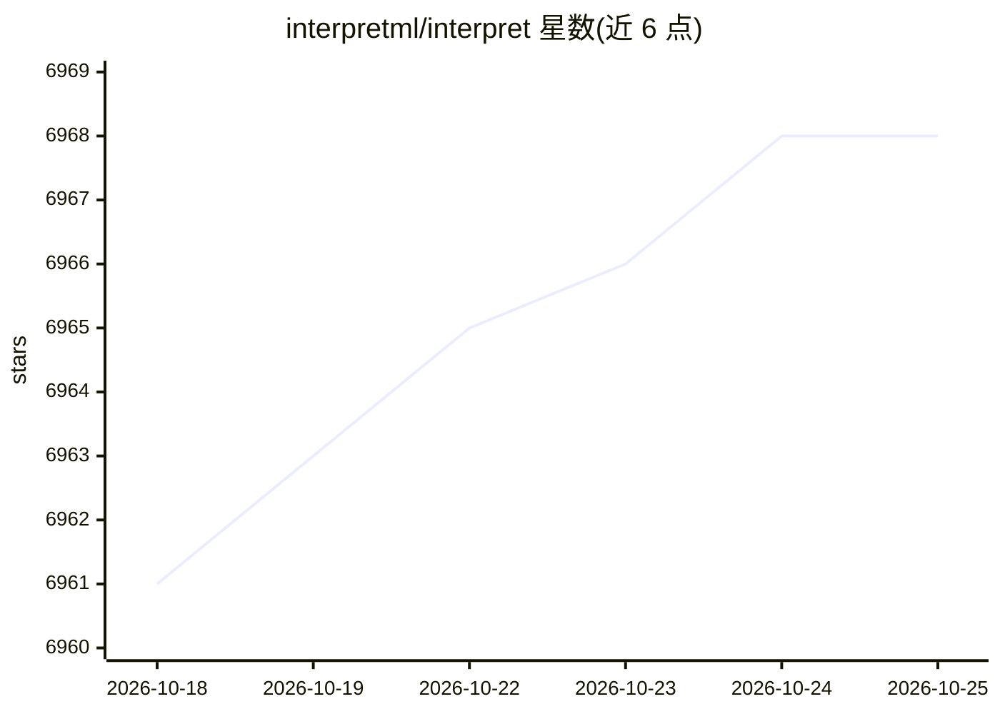

# interpretml/interpret

⭐ 6,968 · C++ · MIT · 推送 2026-10-19 · [GitHub](https://github.com/interpretml/interpret) · [官网](https://interpret.ml/docs) · 组织维护

**机器学习可解释性工具包：训练玻璃盒模型并解释黑盒模型**

微软研究院开发的 Python 开源包，把多种可解释性技术集成在一处：既可训练可解释的玻璃盒模型（核心是 Explainable Boosting Machine，基于 bagging、梯度提升与自动交互检测的 GAM 变体），也可用 SHAP、LIME、Morris 敏感性分析等方法解释已有黑盒模型，提供全局解释、个体预测解释与多模型对比可视化。另提供差分隐私版 EBM，支持千万级样本训练。面向需要模型调试、公平性检测与合规审计的数据科学家与开发者。

## 筛选速览

| 维度 | 判定 | 备注 |
|---|---|---|
| AI 角色 | `ai-native` | 本体是模型或模型工具 |
| 许可风险 | `permissive` | MIT |
| 部署形态 | `library` | 以包/库形式分发 |
| 模型依赖 | — | README 未给出锁定关系 |
| 硬件要求 | — | 无带数字的原话,不猜 |
| 安装摩擦 | `low` | 无编译、无系统依赖或容器化 |
| 成熟度 | — | 结构信号不足 |

## 能力要点

- EBM（Explainable Boosting Machine）玻璃盒模型，产出精确解释且可由领域专家编辑
- 内置 SHAP/LIME/Morris 敏感性分析等黑盒解释器
- 提供差分隐私版本 DPExplainableBoosting 分类与回归模型
- 支持全局解释、个体预测解释与多模型对比展示

## 适用场景

- 训练准确且可解释的分类/回归模型
- 对已有黑盒模型做全局与局部归因解释
- 在高风险场景（医疗/金融）做公平性与合规审查
- 数据敏感场景下用差分隐私 EBM 训练模型

## 场景标签

 · 领域:机器学习/可解释AI

## 证据(README 行号)

> L16: InterpretML is an open-source package that incorporates state-of-the-art machine learning interpretability techniqu
> L53: |Explainable Boosting|glassbox model|
> L58: |SHAP Kernel Explainer|blackbox explainer|

## 星数曲线

2026-10-18 6,961 → 2026-10-25 6,968（+7）

---
*卡片 v1 · prompt 1.4 · 生成 2026-10-20 · 置信度 high · 依据 README sha `acf2d78a3985` · [字段定义](../../DATASET.md)*
