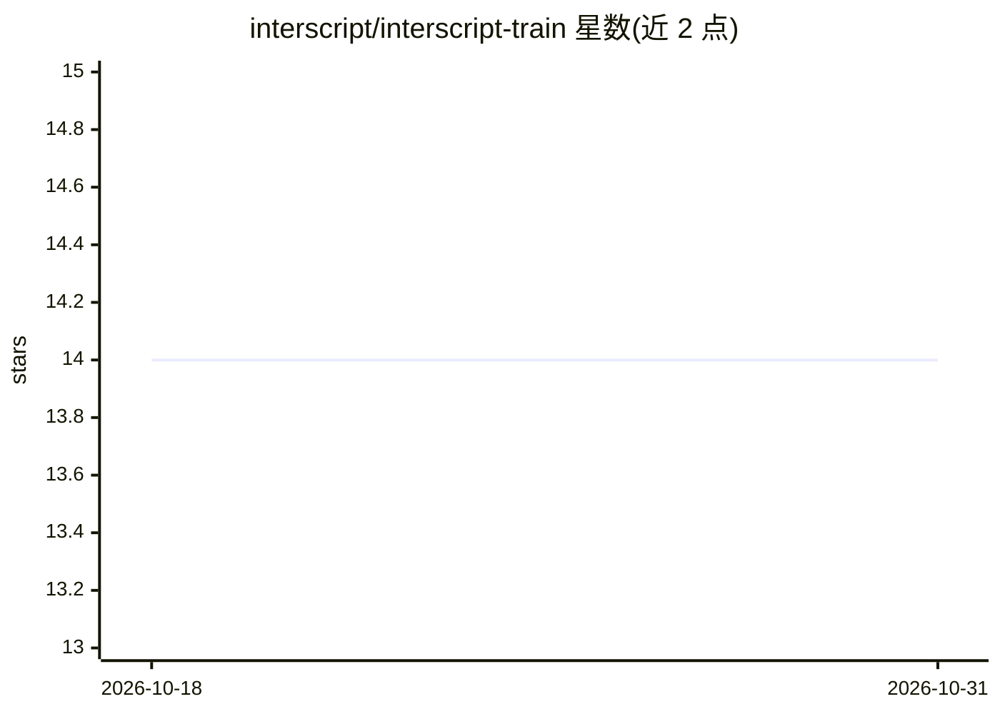

# interscript/interscript-train

⭐ 14 · Python · 推送 2026-10-30 · [GitHub](https://github.com/interscript/interscript-train) · 组织维护

**阿拉伯语与希伯来语自动加音符（元音标注）的神经网络库**

面向中东语言文本自动标注音符（diacritization）的库，支持阿拉伯语与希伯来语，适用场景包括语音合成前处理与罗马化转写。核心机制为文本预处理、CBHG 神经网络预测、后处理三步；阿拉伯语方案基于 almodhfer 的工作，模型可转换为 ONNX 格式，Ruby 库通过 ONNX 运行推理，模型体积合理、可在 CPU 上预测。提供 Python 训练与推理、Ruby 推理，附带测试与基准工具。注意：仓库描述声明本仓库为已归档的原始历史，完整历史已合并至其他仓库；训练数据集 Tashkeela 为 GPL v2 许可。

## 筛选速览

| 维度 | 判定 | 备注 |
|---|---|---|
| AI 角色 | `ai-native` | 本体是模型或模型工具 |
| 许可风险 | `permissive` | — |
| 部署形态 | `library` | 以包/库形式分发 |
| 模型依赖 | — | README 未给出锁定关系 |
| 硬件要求 | — | 无带数字的原话,不猜 |
| 安装摩擦 | `medium` | 含编译或系统依赖之一 |
| 成熟度 | `idea` | |

## 能力要点

- 阿拉伯语与希伯来语双语言的神经网络自动加音符
- 基于 CBHG 模型，支持 CPU 上的高效预测
- PyTorch 转 ONNX，Ruby 库以 ONNX 格式运行模型
- 附带测试与基准工具，可与其它实现对比

## 适用场景

- 为 TTS 语音合成准备带音符的阿拉伯语/希伯来语文本
- 对文本文件批量自动添加音符（diacritization）
- 在 Ruby 项目中以 ONNX 模型运行加音符推理

## 场景标签

 · 领域:自然语言处理/文本规范化

## 证据(README 行号)

> L9: This repository contains everything to train a diacritization model in Python
> L23: Diacritization strategy is following several steps with at heart a deep learning
> L27: . neural networks model prediction

## 星数曲线

2026-10-18 14 → 2026-10-31 14（+0）

---
*卡片 v1 · prompt 1.4 · 生成 2026-10-31 · 置信度 mid · 依据 README sha `a0162c0a9aea` · [字段定义](../../DATASET.md)*
