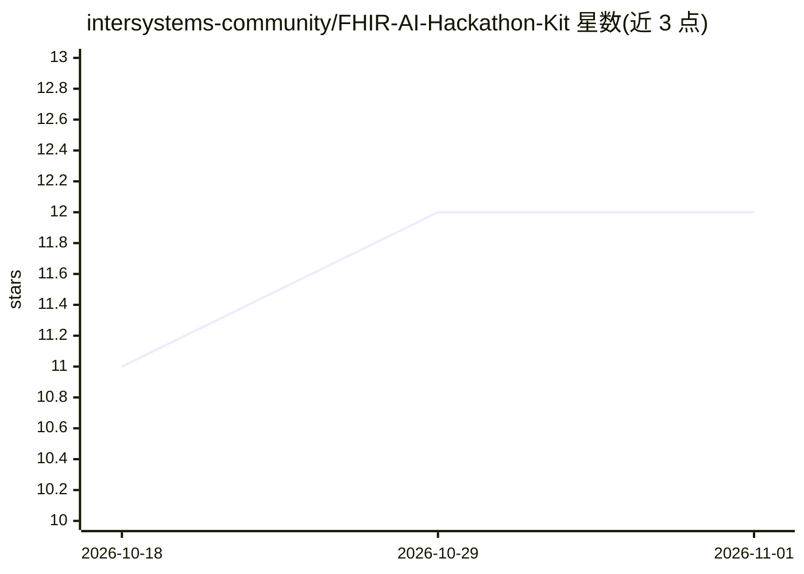

# intersystems-community/FHIR-AI-Hackathon-Kit

⭐ 12 · Jupyter Notebook · MIT · 推送 2026-10-15 · [GitHub](https://github.com/intersystems-community/FHIR-AI-Hackathon-Kit) · [官网](https://community.intersystems.com/post/building-medical-history-chatbot-fhir-vector-search-and-rag-beginners) · 组织维护

**InterSystems IRIS for Health 的 FHIR/AI 动手教程集**

面向初识 InterSystems IRIS 的 Python 开发者的 Jupyter 交互式教程系列：通过 Docker 模板启动带 FHIR 服务器的 IRIS for Health 实例，依次覆盖 CSV/SQL 数据加载与查询、FHIR 数据读写、向量搜索，以及基于 LangChain 的 AI Agent 与 MCP 服务器构建。运行需要 Python、Docker 和 OpenAI API key（全程费用低于 $0.01），可换用其他 LLM 提供商但未提供切换说明。不涉及 ObjectScript 与 IRIS 深层特性。

## 筛选速览

| 维度 | 判定 | 备注 |
|---|---|---|
| AI 角色 | `ai-knowledge` | 知识聚合/清单类 |
| 许可风险 | `permissive` | MIT |
| 部署形态 | `None` |  |
| 模型依赖 | — | README 未给出锁定关系 |
| 硬件要求 | — | 无带数字的原话,不猜 |
| 安装摩擦 | `low` | 无编译、无系统依赖或容器化 |
| 成熟度 | — | 结构信号不足 |

## 能力要点

- Docker 模板一键启动带 FHIR 服务器的 IRIS for Health
- 覆盖 CSV/SQL、FHIR、向量搜索三类数据的完整教程路径
- 包含 LangChain AI Agent 与 MCP 服务器构建教程
- 各数据类型章节自包含，可按需选学

## 适用场景

- 我想快速入门用 Python 操作 InterSystems IRIS 和 FHIR 数据
- 黑客松或原型阶段快速搭建医疗数据+AI Agent 应用
- 学习在医疗数据上做向量搜索与 RAG

## 场景标签

`教程课程` · 领域:学习与行业

## 证据(README 行号)

> L3: Hands-on Jupyter tutorials for building Python applications on InterSystems IRIS for Health. Load CSV and FHIR data,
> L9: This kit is a set of tutorials to demonstrate how users can build applications with InterSystems IRIS for Health, us
> L79: Each of the tutorials are IPython (Jupyter) notebooks. These are notebooks which use a continuous Python kernel wit

## 星数曲线

2026-10-18 11 → 2026-11-01 12（+1）

---
*卡片 v1 · prompt 1.4 · 生成 2026-11-01 · 置信度 high · 依据 README sha `b91f14e9d9ed` · [字段定义](../../DATASET.md)*
