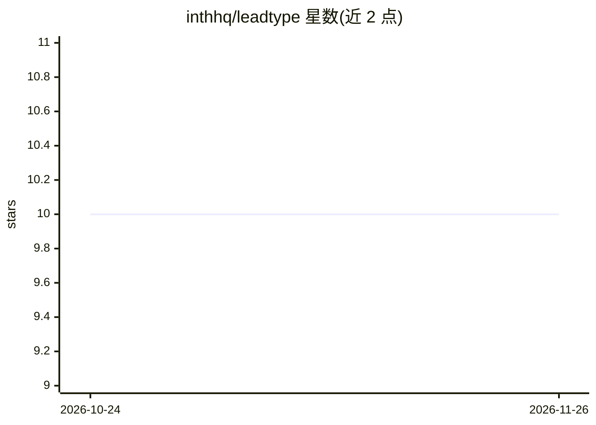

# inthhq/leadtype

⭐ 10 · TypeScript · MIT · 推送 2026-10-30 · [GitHub](https://github.com/inthhq/leadtype) · [官网](https://leadtype.dev) · 个人维护

**为人类与 agent 统一产出文档网站的 MDX 流水线工具**

从单一 MDX 源生成四类产物：人类可浏览的网站、供 HTTP agent 读取的 llms.txt、面向离线编码 agent 的 AGENTS.md 文档包、静态搜索索引。leadtype 不承担文档站框架角色，宿主与 UI 由使用者自选（Next.js、Astro、Nuxt、Fumadocs 等）。CLI 提供 generate、init、lint 子命令；lint 会对路由图、锚点与代码围栏做校验，并可选对 ts 示例做类型检查；支持将 AGENTS.md 与主题 markdown 打进 npm 包供消费方按版本取用。

## 筛选速览

| 维度 | 判定 | 备注 |
|---|---|---|
| AI 角色 | `ai-enhanced` | 去掉 AI 部分产品仍成立 |
| 许可风险 | `permissive` | MIT |
| 部署形态 | `library` | 以包/库形式分发 |
| 模型依赖 | — | README 未给出锁定关系 |
| 硬件要求 | — | 无带数字的原话,不猜 |
| 安装摩擦 | `low` | 无编译、无系统依赖或容器化 |
| 成熟度 | — | 结构信号不足 |

## 能力要点

- 单一 MDX 源生成网站、llms.txt、AGENTS.md 包与搜索索引四种产物
- leadtype lint 对内部链接、代码围栏校验，可选对 ts 示例类型检查
- 支持将版本匹配的文档打包进 npm 包，供消费方 agent 读取
- init 自动从 package.json 检测框架（next/astro/nuxt/sveltekit）

## 适用场景

- 为现有 Web 框架的工程接入文档生成与搜索索引
- 把库文档打包进 npm 包供使用方编码 agent 阅读
- 在 CI 中校验文档内链与代码示例避免失效页面入库

## 场景标签

 · 领域:开发者工具/文档工程

## 证据(README 行号)

> L3: A docs pipeline. Write MDX once. Get a website for humans, an `llms.txt` for HTTP agents, an `AGENTS.md`-fronted bun
> L12: leadtype is **not a docs website framework**. Bring your own host and UI — a custom app, Next.js, TanStack Start, A

## 星数曲线

2026-10-24 10 → 2026-11-26 10（+0）

---
*卡片 v1 · prompt 1.4 · 生成 2026-11-19 · 置信度 mid · 依据 README sha `646484ec0188` · [字段定义](../../DATASET.md)*
