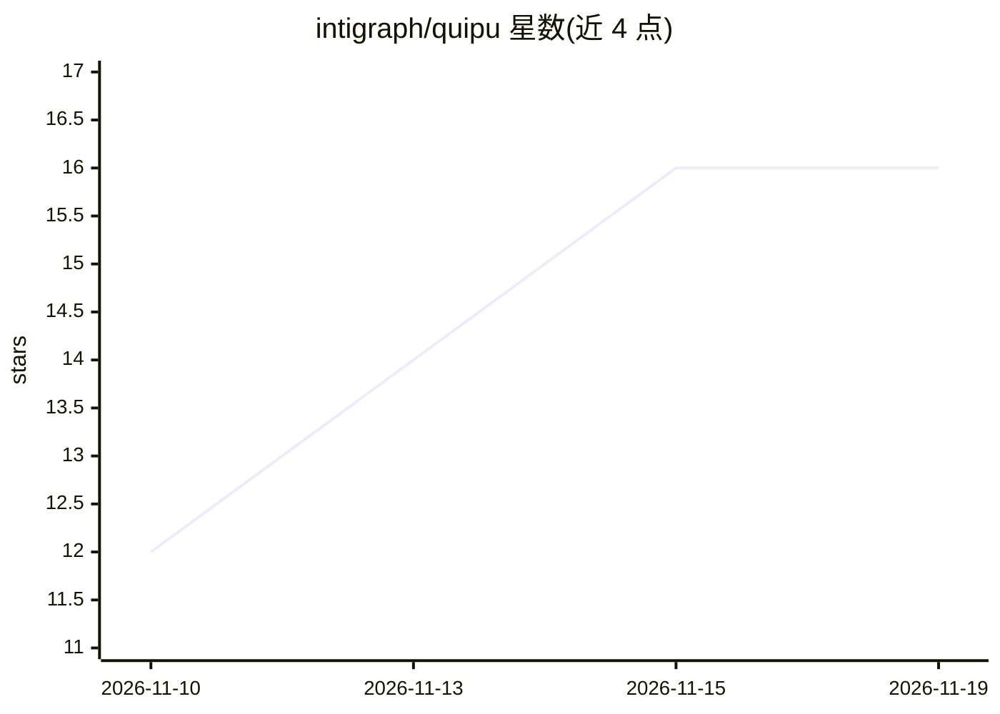

# intigraph/quipu

⭐ 16 · Rust · Apache-2.0 · 推送 2026-11-18 · [GitHub](https://github.com/intigraph/quipu) · [官网](https://intigraph.github.io/quipu/) · 组织维护

**面向 AI agent 的受治理双时态知识图谱存储**

Rust 实现的本地知识存储：以 Turtle 写入事实，按词汇表和 shapes 校验（SHACL/OWL 语境），记录来源与历史并支持 SPARQL 查询当前及历史版本（双时态，可按事务号回读）。提供 CLI、REST 服务器、MCP 服务器与 Rust 库四种接入方式，本地 SQLite 存储，支持经验证的知识包导入与隔离检疫。语义搜索需另配嵌入模型，默认为关键词搜索。属 Tambo 工具栈的核心存储组件，各工具也可独立使用。

## 筛选速览

| 维度 | 判定 | 备注 |
|---|---|---|
| AI 角色 | `ai-ecosystem` | LLM/agent 周边工具 |
| 许可风险 | `permissive` | Apache-2.0 |
| 部署形态 | `library` | 以包/库形式分发 |
| 模型依赖 | — | README 未给出锁定关系 |
| 硬件要求 | — | 无带数字的原话,不猜 |
| 安装摩擦 | `low` | 无编译、无系统依赖或容器化 |
| 成熟度 | — | 结构信号不足 |

## 能力要点

- 写入前按词汇表与 shapes 治理校验，记录事实来源
- 双时态历史：可按事务号回查任一时刻的知识状态
- CLI / REST / MCP / Rust 库四种接入方式，SQLite 本地存储
- 带校验和与来源的知识包导入，隔离检疫后才准入

## 适用场景

- 为多个 agent 提供可共享、可复用的受治理记忆
- 留存并回查事实与决策的历史版本
- 通过 MCP 将知识库接入 Claude Code 等 agent 客户端
- 跨工具以受控方式共享领域知识包

## 场景标签

`知识图谱` `Agent 记忆` · 领域:Agent 开发

## 证据(README 行号)

> L16: **Quipu is a governed, bitemporal knowledge store for AI agents and the
> L23: - **Reusable agent knowledge:** store memory agents can read, reuse and share across tools.

## 星数曲线

2026-11-10 12 → 2026-11-19 16（+4）

---
*卡片 v1 · prompt 1.4 · 生成 2026-11-18 · 置信度 high · 依据 README sha `8b31d757942f` · [字段定义](../../DATASET.md)*
