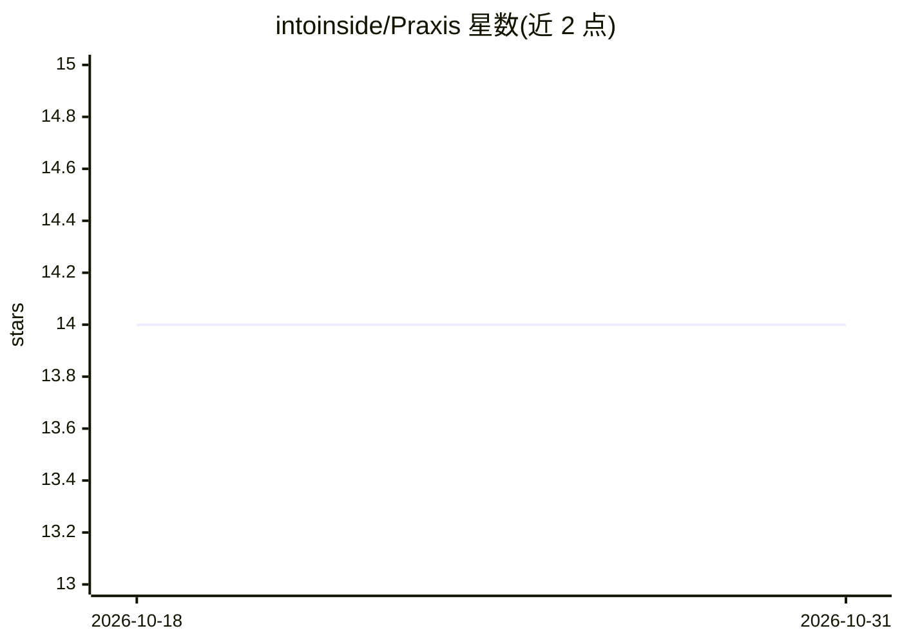

# intoinside/Praxis

⭐ 14 · TypeScript · MIT · 推送 2026-02-24 · [GitHub](https://github.com/intoinside/Praxis) · [官网](https://intoinside.github.io/Praxis/) · 个人维护

**连接意图驱动与规格驱动开发的 TypeScript CLI 框架**

Praxis 是以 Node.js CLI 形式分发的开发框架，将意图驱动开发（IDD）与规格驱动开发（SDD）合并为单一工作流：先记录构建某功能的意图（why），再从意图推导可验证的规格（what），最后检查代码实现（how）与意图是否漂移。支持在 IDE AI 聊天中以斜杠命令调用，也可无 AI 集成独立使用；内置基于 MQTT 的后台 agent（含嵌入式 Aedes broker）处理异步任务，agent 可经配置调用 LLM。README 声明项目处于活跃开发中，API、命令名与文件格式可能变化，命令表中多项标记为未实现或不确定。

## 筛选速览

| 维度 | 判定 | 备注 |
|---|---|---|
| AI 角色 | `ai-ecosystem` | LLM/agent 周边工具 |
| 许可风险 | `permissive` | MIT |
| 部署形态 | `library` | 以包/库形式分发 |
| 模型依赖 | — | README 未给出锁定关系 |
| 硬件要求 | — | 无带数字的原话,不猜 |
| 安装摩擦 | `low` | 无编译、无系统依赖或容器化 |
| 成熟度 | `idea` | |

## 能力要点

- 意图创建、验证与规格推导的可追溯链路
- 意图/规格/代码三层漂移检测（命令表中标为未实现）
- 基于 MQTT 5 共享订阅的后台 agent 与嵌入式 broker（Aedes）
- CLI 优先设计，可映射为 IDE 斜杠命令或 MCP 式本地命令服务

## 适用场景

- 在编码前定义并验证意图与规格，保持需求可追溯
- 通过 AI 聊天斜杠命令或 CLI 管理意图与规格
- 用后台 agent 异步执行长任务并调用 LLM

## 场景标签

 · 领域:软件开发流程工具

## 证据(README 行号)

> L12: **Praxis** is a development framework that bridges **Intent‑Driven Development (IDD)** and **Spec‑Driven Developmen
> L20: * **AI‑native** (usable from AI chats inside modern IDEs)
> L21: * **CLI‑first** (works without any IDE or AI integration)

## 星数曲线

2026-10-18 14 → 2026-10-31 14（+0）

---
*卡片 v1 · prompt 1.4 · 生成 2026-10-31 · 置信度 high · 依据 README sha `d4dddce6afba` · [字段定义](../../DATASET.md)*
