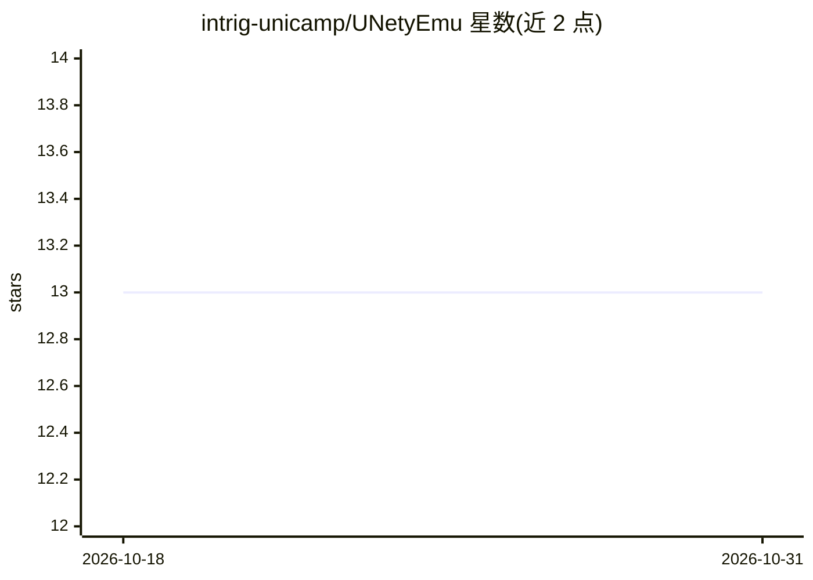

# intrig-unicamp/UNetyEmu

⭐ 13 · C# · 推送 2026-05-11 · [GitHub](https://github.com/intrig-unicamp/UNetyEmu) · [官网](https://github.com/intrig-unicamp/UNetyEmu/wiki) · 组织维护

**城市环境中多飞行器/地面车辆 Unity 仿真器，集成 ROS2 传感器**

基于 Unity 的多载具仿真器，扩展自 UNetyEmu：提供物理接地的动力学引擎（单电机力、级联 PID 姿态控制、驱动盘能耗建模，载货会涌现性地改变推力需求与电池消耗），以及模块化 ROS2 传感器桥，可向任意载具挂载 360-LiDAR、RGB/深度相机、IMU、GPS 并以标准 sensor msgs 话题发布。面向需要测试通信感知算法、路径规划、目标检测（含 YOLOv8 demo）的研究者。支持 Ubuntu 22.04 + ROS2 Humble，提供预构建可执行文件快速 demo、23GB 预配置 VirtualBox 虚拟机镜像及 Unity Editor 完整工程三种运行方式。

## 筛选速览

| 维度 | 判定 | 备注 |
|---|---|---|
| AI 角色 | `ai-ecosystem` | LLM/agent 周边工具 |
| 许可风险 | `none` | — |
| 部署形态 | `desktop` | 安装包/桌面程序 |
| 模型依赖 | — | README 未给出锁定关系 |
| 硬件要求 | — | 无带数字的原话,不猜 |
| 安装摩擦 | `medium` | 含编译或系统依赖之一 |
| 成熟度 | — | 结构信号不足 |

## 能力要点

- 物理接地动力学引擎：载货作为涌现行为改变推力、惯量与电池消耗
- 模块化 ROS2 传感器桥：LiDAR/RGB/深度相机/IMU/GPS 以标准话题发布
- 异构无人机与地面车辆同场景并发运行（快递配送、目标检测、遥操作）
- 三种运行方式：预构建可执行文件、VirtualBox 虚拟机镜像、Unity Editor 工程

## 适用场景

- 在城市场景中测试无人机的路径规划与避障算法
- 通过 ROS2 话题获取传感器数据做目标检测（YOLOv8）
- 在统一仿真环境中并发测试异构无人机与地面车辆的协同配送任务

## 场景标签

`目标检测` · 领域:感知与多模态

## 证据(README 行号)

> L9: We present UNetyEmuROS, a Unity-based multi-vehicle simulator that extends our previous work UNetyEmu with two key c

## 星数曲线

2026-10-18 13 → 2026-10-31 13（+0）

---
*卡片 v1 · prompt 1.4 · 生成 2026-10-31 · 置信度 mid · 依据 README sha `cbb532bf8bcb` · [字段定义](../../DATASET.md)*
